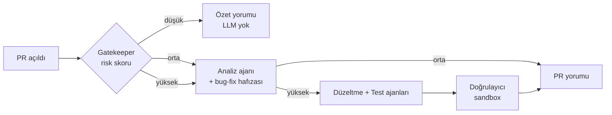

# 🛡️ Aegis

**Risk odaklı, hafızalı ve çok ajanlı PR inceleme sistemi.**

Aegis bir Pull Request açıldığında üç adımda çalışır:

1. Değişikliğin riskini **klasik bir ML modeliyle** ölçer ve düşük riskli PR'ları LLM'e hiç göndermez.
2. Riskli PR'ları incelerken LLM'e **reponun kendi geçmiş hatalarını** hatırlatır.
3. Bulduğu sorun için **testle doğrulanmış** bir düzeltme üretir ve bunu tek tıkla kabul edilebilen bir GitHub *suggestion* bloğu olarak yayınlar.

> **Durum:** Geliştirme aşaması · **Hedef dil:** Python · **Teslim şekli:** GitHub Action + CLI

---

## Neden?

| Mevcut yaklaşım | Eksik kalan | Aegis'in cevabı |
| --- | --- | --- |
| LLM PR botları (PR-Agent, CodeRabbit, Copilot review) | Her PR'a LLM çağırır; repo geçmişini bilmez; önerilerini doğrulamaz | **Gatekeeper** düşük riskli PR'ları eler · **Bug-fix hafızası** geçmişi hatırlatır · **Doğrulayıcı** öneriyi testle sınar |
| JIT hata tahmini (SZZ + Git metrikleri + RF/XGBoost) | "%75 hatalı" der ama hatanın ne olduğunu söylemez, düzeltme önermez | Tahmin sonucunu LLM için bir **maliyet kapısı** olarak kullanır ve bir **aksiyona** dönüştürür |

## Nasıl Çalışır?



PR'da çıkan sonuç şöyle görünür:

> **🛡️ Aegis — Risk: 0.82 (yüksek)**
> Neden: bu fonksiyonda geçmişte 2 hata düzeltilmiş · 3 alt sisteme yayılan değişiklik
> Hafıza: `BC-0142` (#89, bağlantı havuzu sızıntısı)
> Sonuç: 1 bulgu · 1 doğrulanmış öneri · 0,006 $

## Fazlar

| Faz | İçerik | Sonuç |
| --- | --- | --- |
| 0 | Altyapı | CI, tip kontrolü, geliştirme ortamı |
| 1 | **Uçtan uca iskelet** | Sezgisel gatekeeper + tek LLM çağrısı + PR yorumu. İlk günden demo yapılabilir. |
| 2 | Repo madenciliği | PyDriller, fix-commit tespiti, SZZ, JIT metrikleri |
| 3 | ML Gatekeeper | Sezgisel kuralın yerine eğitilmiş, açıklanabilir risk modeli gelir |
| 4 | Bug-fix hafızası | Hata kartları, hibrit arama, analiz ajanına bağlam |
| 5 | Patch ve doğrulama | Düzeltme/test ajanları, sandbox, suggestion blokları |
| 6 | Değerlendirme | Ablation deneyleri ve rakip araçlarla karşılaştırma |
| 7 | Sunum ve tez | [docs/presentation.md](docs/presentation.md) |

Her faz bir önceki fazın çalışan sistemini derinleştirir. Ayrıntılı görevler [TODO.md](TODO.md) dosyasında ve [GitHub Issues](https://github.com/mhmtemnbgr1/Aegis/issues) altında.

## Kullanım

### Yerelde

```bash
aegis score  --base main          # yalnızca risk skoru
aegis review --base main          # gatekeeper + analiz ajanı; sonuç terminale
aegis review --base main --no-llm # LLM'siz, yalnızca deterministik kurallar
```

Planlanan (Faz 2–4): `aegis mine`, `aegis train`, `aegis index`, `aegis publish-state`.

### GitHub Action

`.github/workflows/aegis.yml`:

```yaml
name: Aegis
on:
  pull_request:            # pull_request_target KULLANMAYIN

permissions:
  contents: read
  pull-requests: write     # özet ve satır yorumları
  checks: write            # check run

jobs:
  review:
    runs-on: ubuntu-latest
    steps:
      - uses: actions/checkout@v4
        with:
          fetch-depth: 0   # base...head diff'i için tam geçmiş
      - uses: mhmtemnbgr1/Aegis@main
        with:
          gemini-api-key: ${{ secrets.GEMINI_API_KEY }}
```

- Yapılandırma (`.aegis.toml`) ve `.aegisignore` **taban dalın** sürümünden okunur; PR kendi incelemesini gevşetemez.
- **Fork PR'larında** gizli anahtar kullanılmaz ve kod dışarı gönderilmez: yalnızca gatekeeper ve (varsa) yerel Ollama modeli çalışır.
- Aegis PR'ı **asla bloklamaz**: kendi hatasında check run `neutral` olur ve özet yorumunda uyarı bırakılır.
- Her çalıştırmanın metrikleri `aegis-runs-*` artifact'ı olarak yüklenir.

Tüm seçenekler: [`action.yml`](action.yml) · [`.aegis.toml.example`](.aegis.toml.example)

## Dokümanlar

| Dosya | İçerik |
| --- | --- |
| [docs/rad.md](docs/rad.md) | Gereksinim Analiz Dokümanı (RAD): kapsam, hedefler, FR/NFR, senaryolar, UML modelleri, arayüz taslakları |
| [docs/setup.md](docs/setup.md) | Geliştirme ortamı: uv, Ollama, Gemini anahtarı |
| [docs/architecture.md](docs/architecture.md) | Gereksinimler, katman ayrıntıları, şemalar, modüller, teknoloji yığını, güvenlik |
| [docs/presentation.md](docs/presentation.md) | Sunum ve tez: katkılar, araştırma soruları, değerlendirme planı, demo, jüri soruları |
| [docs/target-repos.md](docs/target-repos.md) | Eğitim ve değerlendirmede kullanılan repolar |
| [docs/ideas.md](docs/ideas.md) | Kapsam dışı fikirler |

## Geliştirme

```bash
uv sync --all-extras        # LLM SDK'ları dahil; tek sağlayıcı için: --extra ollama
uv run pre-commit install   # commit öncesi ruff, ruff-format, mypy
uv run ruff check .
uv run mypy
uv run pytest
```

## Lisans

[MIT](LICENSE)
