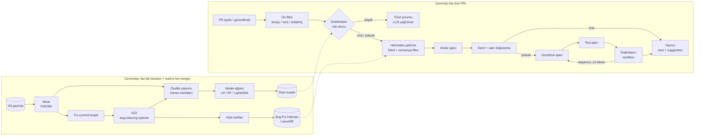
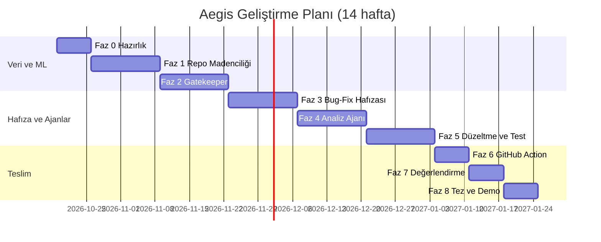

# 🛡️ Aegis — Risk Odaklı, Hafızalı ve Çok Ajanlı PR İnceleme Sistemi

> Pull Request açıldığında önce **klasik bir ML modeliyle** değişikliğin riskini ölçen, yalnızca riskli değişiklikleri LLM'e ileten, LLM'e **reponun kendi geçmiş hatalarını** hatırlatan ve sonunda geliştiricinin tek tıkla kabul edebileceği, **test ile doğrulanmış** bir GitHub *suggestion* bloğu üreten hibrit kod inceleme sistemi.

**Durum:** Planlama aşaması · **Tür:** Bitirme Projesi · **Teslim şekli:** GitHub Action + CLI · **Hedef dil (v1):** Python

---

## İçindekiler

1. [Problem ve Motivasyon](#1-problem-ve-motivasyon)
2. [Mevcut Çözümler ve Boşluk](#2-mevcut-çözümler-ve-boşluk)
3. [Katkılar, Araştırma Soruları ve Başarı Kriterleri](#3-katkılar-araştırma-soruları-ve-başarı-kriterleri)
4. [Kapsam](#4-kapsam)
5. [Gereksinimler](#5-gereksinimler)
6. [Mimari](#6-mimari)
7. [Teknoloji Yığını](#7-teknoloji-yığını)
8. [Faz Faz Geliştirme Planı](#8-faz-faz-geliştirme-planı)
9. [Değerlendirme](#9-değerlendirme)
10. [Maliyet Planı](#10-maliyet-planı)
11. [Riskler ve Önlemler](#11-riskler-ve-önlemler)
12. [Dizin Yapısı](#12-dizin-yapısı)
13. [Yapılandırma Örneği](#13-yapılandırma-örneği)
14. [Ekip ve Çalışma Düzeni](#14-ekip-ve-çalışma-düzeni)
15. [Kaynakça](#15-kaynakça)

---

## 1. Problem ve Motivasyon

Endüstride ve akademide kod incelemesi otomasyonu iki ayrı dünyada gelişti ve bu iki dünya birbirine dokunmuyor:

- **LLM tabanlı PR botları** her PR'ı (5 satırlık bir CSS düzeltmesini bile) büyük bir modele gönderiyor. Bu hem **token israfı** hem gecikme demek. Üstelik kodu yalnızca o anki diff bağlamında inceliyorlar: repoda 6 ay önce aynı modülde yaşanmış bir race condition'dan ya da regression'dan habersizler.
- **Akademik Just-In-Time (JIT) hata tahmini** modelleri (SZZ + Git metrikleri + Random Forest/XGBoost) yıllardır "bu commit %75 ihtimalle hatalı" diyebiliyor. Ancak hatanın **ne olduğunu söylemiyor, düzeltme önermiyor**. Bu yüzden geliştirici için çıktıları kullanışsız kalıyor ve endüstride karşılık bulamıyor.

**Aegis'in tezi:** Bu iki yaklaşımı tek bir hattın ardışık katmanları olarak birleştirmek.

1. Ucuz, hızlı ve açıklanabilir bir ML modeli **hangi PR'ın incelenmeye değer olduğuna** karar verir (*gatekeeper*).
2. Pahalı LLM yalnızca riskli PR'larda ve **reponun kendi bug-fix geçmişiyle beslenerek** çalışır (*repo hafızası*).
3. Çıktı bir olasılık yüzdesi değil, **test ile doğrulanmış bir düzeltme önerisidir** (*çok ajanlı patch üretimi*).

> "Tekerleği yeniden icat etmiyoruz. Endüstrideki iki büyük kopukluğu (maliyet-körü LLM botları ile aksiyonsuz akademik tahmin modelleri) hibrit bir mimaride birleştiriyoruz."

---

## 2. Mevcut Çözümler ve Boşluk

| Yaklaşım | Örnekler | Ne yapıyor? | Eksik kalan |
| --- | --- | --- | --- |
| LLM PR botları | PR-Agent (Qodo/Codium), CodeRabbit, GitHub Copilot code review | Diff'i LLM'e gönderip özet ve bulgu yorumu üretiyor | Repo geçmişi hafızası yok, her PR'a LLM çağırıyor, öneriler doğrulanmıyor |
| JIT hata tahmini (MSR) | Kamei vd. (2013), DeepJIT, CC2Vec, JITLine; PyDriller + SZZ ile kurulan modeller | Commit'in hatalı olma olasılığını tahmin ediyor | Hatanın ne olduğunu açıklamıyor, düzeltme önermiyor, iş akışına girmiyor |
| Statik analiz / kural tabanlı | Semgrep, CodeQL, gitleaks, Ruff | Bilinen kalıpları deterministik olarak yakalıyor | İş mantığı hatalarını ve repoya özgü geçmişi göremiyor |
| Otomatik program onarımı (APR) | LLM tabanlı APR çalışmaları, BugsInPy/Defects4J üzerindeki benchmark'lar | Bilinen bir hata için patch üretiyor | Hatanın **nerede** olduğunu önceden bilmeyi varsayıyor, PR akışına bağlı değil |

**Aegis'in konumu:** JIT tahminini **kapı (triage)**, bug-fix geçmişini **bağlam (RAG)**, APR'yi **aksiyon** olarak kullanan; üçünü PR iş akışında birleştiren ilk bütüncül açık kaynak araç olmayı hedefler.

> Bu karşılaştırma tablosu, tezin "İlgili Çalışmalar" bölümünde güncel literatür taramasıyla doğrulanacak ve genişletilecektir.

---

## 3. Katkılar, Araştırma Soruları ve Başarı Kriterleri

### 3.1 Üç Temel Katkı

**K1 — Gatekeeper ile maliyet optimizasyonu.**
Kamei metrikleri ve repo geçmişinden çıkarılan özelliklerle eğitilmiş bir sınıflandırıcı, her PR'a bir risk skoru verir. Düşük riskli PR'lar LLM'e hiç gitmez, orta riskliler yalnızca analiz edilir, yüksek riskliler tam ajan zincirinden geçer. Böylece maliyet/performans dengesi **ölçülebilir ve ayarlanabilir** hale gelir.

**K2 — Repo'ya özgü bug-fix hafızası.**
Reponun geçmişteki `fix:` / `bug:` commit'leri, SZZ ile bulunan hatayı-getiren (bug-inducing) commit'leri ve bağlı issue'ları bir vektör veritabanında "hata kartları" olarak saklanır. LLM'e şu bağlam verilebilir: *"Bu fonksiyon 4 ay önce değiştirildiğinde #89 numaralı bellek sızıntısı oluştu ve şu şekilde düzeltildi."*

**K3 — Tahminden aksiyona: doğrulanmış patch.**
Analiz → Düzeltme → Test ajanları zinciri ve deterministik bir doğrulayıcı, hatayı yeniden üreten bir test yazar, patch'i uygular ve testleri koşturur. Yalnızca doğrulanan patch'ler GitHub'da tek tıkla kabul edilebilen `suggestion` bloğu olarak yayınlanır.

### 3.2 Araştırma Soruları

| ID | Soru |
| --- | --- |
| **RQ1** | Gatekeeper, LLM çağrılarını ve maliyeti ne kadar azaltır; bu sırada hatalı değişikliklerin ne kadarı kaçırılır? |
| **RQ2** | Repo'ya özgü bug-fix hafızası, LLM'in hata tespit doğruluğunu (precision/recall) hafızasız incelemeye göre artırır mı? |
| **RQ3** | Test ile doğrulanan çok ajanlı zincir, tek çağrıyla patch üretmeye göre daha fazla **doğru** patch üretir mi? |
| **RQ4** | Uçtan uca sistem, PR başına maliyet ve gecikme açısından pratikte kullanılabilir mi? |

### 3.3 Başarı Kriterleri (ilk hedefler)

> Hedefler Faz 1 sonunda pilot veriyle gözden geçirilip revize edilecektir.

| Metrik | Hedef |
| --- | --- |
| Gatekeeper: LLM'e gitmeden geçen PR oranı | ≥ %50 |
| Gatekeeper: hatalı (SZZ ile etiketli) değişikliklerin yakalanma oranı (recall) | ≥ %80 |
| Hafızalı analiz: tespit F1'inde hafızasız analize göre iyileşme | istatistiksel olarak anlamlı, ≥ %10 göreli |
| Patch: BugsInPy alt kümesinde testleri geçen (plausible) patch oranı | ≥ %25 |
| Yayınlanan suggestion'ların doğrulanmış olma oranı | %100 (doğrulanmayan patch suggestion olarak yayınlanmaz) |
| PR başına ortalama maliyet (gatekeeper açık) | ≤ 0,05 $ |
| PR başına uçtan uca süre (p95, test koşumu dahil) | ≤ 5 dk |

---

## 4. Kapsam

### 4.1 Neden PR Botu?

| Seçenek | Karar | Gerekçe |
| --- | --- | --- |
| **GitHub Action (PR botu)** | ✅ Ana teslim şekli | Suggestion bloğu PR'da bulunuyor; hafıza CI'da güncellenebiliyor; patch testleri izole bir runner'da koşuyor; MSR literatürü commit/PR düzeyinde değerlendirme yapıyor |
| **CLI** | ✅ Destekleyici | Modeli eğitmek, indeksi kurmak, yerelde inceleme yapmak ve benchmark koşturmak için gerekli. Action da aynı CLI'ı çağırıyor |
| Pre-push hook | ❌ v1 dışı | Test koşturmak ve hafızayı güncellemek geliştiricinin push anında pratik değil; katkılara bir şey eklemiyor |
| GitHub App | ❌ v1 dışı | Sunucu barındırma gerektiriyor; Action aynı değeri altyapısız sağlıyor |

### 4.2 Kapsam İçi (v1)

- **Repo madenciliği:** PyDriller ile commit geçmişi, fix-commit tespiti, SZZ ile bug-inducing commit eşlemesi
- **Gatekeeper:** Kamei JIT metrikleri ve ek özelliklerle model eğitimi, zamana duyarlı doğrulama, SHAP açıklamaları, risk bantları
- **Bug-fix hafızası:** hata kartları, fonksiyon düzeyinde parçalama, hibrit arama (yapısal + BM25 + vektör), zamansal sızıntı koruması
- **Ajanlar:** Analiz, Düzeltme ve Test ajanları; deterministik Doğrulayıcı; sınırlı geri besleme döngüsü
- **GitHub entegrasyonu:** Action, özet yorumu, satır yorumları, `suggestion` blokları
- **CLI:** `mine`, `train`, `index`, `score`, `review`, `eval`
- Birden fazla LLM sağlayıcısı: Ollama (yerel), Gemini, OpenAI, Anthropic
- Değerlendirme altyapısı ve tez deneyleri

### 4.3 Kapsam Dışı (bilinçli olarak)

- Python dışındaki diller için patch üretimi ve test doğrulaması. Gatekeeper metrikleri dilden bağımsız olduğu için risk skoru her repoda çalışır, ancak v1'de yalnızca Python değerlendirilir.
- Pre-push hook, IDE eklentisi, GitHub App, GitLab/Bitbucket desteği
- LLM veya embedding modeli ince ayarı (fine-tuning)
- Fork'tan gelen PR'larda gizli anahtar gerektiren bulut LLM'leri (bkz. [Riskler](#11-riskler-ve-önlemler))

> ⚠️ Üç katmanlı bu mimaride en büyük risk **kapsam kaymasıdır (scope creep)**. Her katman tek başına bir bitirme projesi olabilir. Yeni fikirler `docs/ideas.md` dosyasına yazılır ve v1 bitmeden uygulanmaz.

---

## 5. Gereksinimler

### 5.1 Fonksiyonel Gereksinimler

**Repo madenciliği**

| ID | Gereksinim | Öncelik |
| --- | --- | --- |
| FR-01 | `aegis mine <repo>` komutu commit geçmişini PyDriller ile tarar ve commit, dosya ve fonksiyon düzeyindeki değişiklikleri kaydeder. | Must |
| FR-02 | Fix commit'leri mesaj kalıplarıyla (`fix`, `bug`, `regression`, `leak`, `crash`, `closes #N` vb.) ve varsa GitHub issue etiketleriyle (`bug`) tespit edilir. | Must |
| FR-03 | Her fix commit'i için SZZ ile bug-inducing commit'ler bulunur. Boşluk, yorum ve boş satır değişiklikleri yok sayılır; merge commit'leri ve çok büyük commit'ler elenir. | Must |
| FR-04 | Kamei vd. (2013) tarafından tanımlanan 14 JIT metriği (NS, ND, NF, Entropy, LA, LD, LT, FIX, NDEV, AGE, NUC, EXP, REXP, SEXP) her commit için hesaplanır. | Must |
| FR-05 | Madencilik artımlıdır: yalnızca son taramadan sonraki commit'ler işlenir. | Should |

**Gatekeeper**

| ID | Gereksinim | Öncelik |
| --- | --- | --- |
| FR-10 | `aegis train` komutu, madencilik verisinden risk modeli eğitir. Doğrulama zaman sıralıdır; rastgele çapraz doğrulama kullanılmaz. | Must |
| FR-11 | Model, PR düzeyinde 0–1 arası bir risk skoru üretir. PR'daki commit'ler birleştirilmiş diff üzerinden değerlendirilir. | Must |
| FR-12 | Ek özellikler: dokunulan dosya/fonksiyonların geçmiş hata yoğunluğu (hafızadan), riskli yol ve API kalıpları, test dosyası değişim oranı. | Should |
| FR-13 | Risk skoru üç banda ayrılır: **düşük** (LLM yok), **orta** (yalnızca Analiz ajanı), **yüksek** (tam zincir). Eşikler config'den veya "PR'ların en fazla %X'i LLM'e gitsin" bütçesinden belirlenir. | Must |
| FR-14 | Her skor için en etkili 3 özellik SHAP ile açıklanır ve PR yorumunda gösterilir. | Should |
| FR-15 | Geçmişi az olan repolarda (soğuk başlangıç) diğer repolarda eğitilmiş genel model kullanılır. | Should |
| FR-16 | PR'a `aegis:force` etiketi eklenerek gatekeeper atlanır ve tam inceleme zorlanır. | Could |

**Bug-fix hafızası**

| ID | Gereksinim | Öncelik |
| --- | --- | --- |
| FR-20 | `aegis index` her fix commit'inden bir **hata kartı** üretir: fix SHA ve tarihi, bug-inducing SHA'lar, dosyalar, fonksiyonların nitelikli adları, commit mesajı, issue no/başlığı, fonksiyonun önceki/sonraki hali, fix diff'i. | Must |
| FR-21 | Kod fonksiyon düzeyinde parçalanır (Python `ast`). | Must |
| FR-22 | Arama hibrittir: (1) aynı dosya/fonksiyon eşleşmesi, (2) BM25 ile tanımlayıcı araması, (3) vektör benzerliği. Sonuçlar Reciprocal Rank Fusion ile birleştirilir. | Must |
| FR-23 | **Zamansal koruma:** Bir PR için yalnızca PR tarihinden önce oluşturulmuş hata kartları getirilir. Değerlendirmede de aynı kural geçerlidir. | Must |
| FR-24 | `main`'e her merge'de yeni fix commit'leri hafızaya artımlı olarak eklenir. | Should |
| FR-25 | Hata kartına indeksleme sırasında ucuz bir modelle kısa bir "kök neden / düzeltme kalıbı" özeti eklenir. | Could |

**Ajanlar ve doğrulama**

| ID | Gereksinim | Öncelik |
| --- | --- | --- |
| FR-30 | **Analiz ajanı** diff'i, çevre bağlamı, gatekeeper açıklamasını ve getirilen hata kartlarını alır; JSON Schema'ya uygun bulgular üretir. Her bulgu kullandığı hata kartlarını (`memory_refs`) belirtir. | Must |
| FR-31 | Bulgunun `evidence` alanı diff'te birebir yoksa veya bulgu satırı değişen satırlara denk gelmiyorsa bulgu düşürülür (halüsinasyon filtresi). | Must |
| FR-32 | **Düzeltme ajanı**, eşiği geçen her bulgu için yalnızca ilgili hunk bölgesini değiştiren minimal bir unified diff üretir. | Must |
| FR-33 | **Test ajanı**, hatayı yeniden üreten bir pytest testi yazar: test PR'ın son halinde başarısız olmalı, patch uygulandıktan sonra geçmelidir. | Must |
| FR-34 | **Doğrulayıcı** (LLM değil, deterministik): `git apply --check`, syntax/lint kontrolü, mevcut testler ve üretilen test (patch öncesi ve sonrası). Sonuç: `verified` / `plausible` / `unverified`. | Must |
| FR-35 | Doğrulama başarısızsa hata çıktısı Düzeltme ajanına geri verilir; en fazla 2 tekrar denenir. | Must |
| FR-36 | Testler ağ erişimi olmayan, kaynak ve süre sınırlı bir sandbox'ta (Docker) koşturulur. | Must |
| FR-37 | Her ajan için sağlayıcı ve model ayrı seçilebilir (ör. analiz için güçlü, test için ucuz model). | Should |

**GitHub entegrasyonu ve CLI**

| ID | Gereksinim | Öncelik |
| --- | --- | --- |
| FR-40 | Aegis, `pull_request` olayında çalışan bir GitHub Action olarak paketlenir. | Must |
| FR-41 | PR'a tek bir **özet yorumu** yazılır: risk skoru ve bandı, SHAP açıklaması, kullanılan hata kartları, bulgu sayısı, token ve maliyet. Yeni push'ta yorum güncellenir, tekrar eklenmez. | Must |
| FR-42 | `verified` patch'ler, değişen satırlarla örtüşen ardışık bir aralığa sığıyorsa satır yorumu içinde ` ```suggestion ` bloğu olarak yayınlanır. Sığmıyorsa açılır-kapanır bir diff olarak yayınlanır. | Must |
| FR-43 | `plausible` patch'ler uyarı etiketiyle, `unverified` olanlar yalnızca bulgu açıklaması olarak (kodsuz) yayınlanır. | Must |
| FR-44 | `aegis review --base main` aynı hattı yerelde çalıştırır ve sonucu terminale basar. | Must |
| FR-45 | Her çalıştırmanın metrikleri (aşama süreleri, token, maliyet, karar, bulgular) JSONL olarak kaydedilir. | Should |
| FR-46 | Geliştirici bir öneriyi 👍/👎 tepkisiyle değerlendirebilir; tepkiler değerlendirme için toplanır. | Could |

### 5.2 Fonksiyonel Olmayan Gereksinimler

| ID | Gereksinim |
| --- | --- |
| NFR-01 | **Güvenilirlik (fail-open):** Aracın kendi hatası (API, ağ, model) PR'ı asla bloklamaz. Yalnızca bir uyarı yorumu bırakılır ve check "neutral" sonuçlanır. |
| NFR-02 | **Güvenlik:** `pull_request_target` kullanılmaz. Üretilen testler gizli anahtarlara erişimi olmayan, ağı kapalı bir sandbox'ta çalışır. |
| NFR-03 | **Gizlilik:** Kod yalnızca seçilen sağlayıcıya gider. `provider = "ollama"` ve yerel embedding modeliyle tamamen çevrimdışı çalışır. |
| NFR-04 | **Tekrarlanabilirlik:** Madencilik verisi, model ve indeks sürümlenir; her deney config + commit SHA + veri sürümüyle yeniden koşturulabilir. |
| NFR-05 | **Açıklanabilirlik:** Her karar (atlandı / analiz edildi / patch üretildi) PR yorumunda gerekçesiyle gösterilir. |
| NFR-06 | **Test edilebilirlik:** Çekirdek modüllerde ≥ %80 test kapsamı; LLM ve GitHub çağrıları mock'lanabilir. |
| NFR-07 | **Genişletilebilirlik:** Yeni dil, sağlayıcı, ajan veya özellik eklemek tek bir protokolü uygulamakla mümkündür. |

---

## 6. Mimari

### 6.1 Genel Bakış: Çevrimdışı ve Çevrimiçi Hatlar



### 6.2 Katman 1 — Gatekeeper

| Grup | Özellikler | Kaynak |
| --- | --- | --- |
| Yayılım (diffusion) | NS (alt sistem), ND (dizin), NF (dosya), Entropy (değişikliğin dosyalara dağılımı) | Kamei vd. 2013 |
| Boyut | LA (eklenen), LD (silinen), LT (dosyanın önceki boyutu) | Kamei vd. 2013 |
| Amaç | FIX (değişiklik bir düzeltme mi) | Kamei vd. 2013 |
| Geçmiş | NDEV (dosyaya dokunan geliştirici sayısı), AGE (son değişiklikten bu yana süre), NUC (benzersiz değişiklik sayısı) | Kamei vd. 2013 |
| Deneyim | EXP, REXP, SEXP (geliştiricinin genel, yakın dönem ve alt sistem deneyimi) | Kamei vd. 2013 |
| **Aegis'e özgü** | Dokunulan fonksiyonların geçmiş hata kartı sayısı, riskli yol (`auth`, `db`, `payment`…), riskli API (`eval`, `subprocess`, SQL string birleştirme…), test değişim oranı | Bu çalışma |

- **Etiketler:** SZZ ile bulunan bug-inducing commit'ler pozitif sınıftır. SZZ etiketlerinin gürültülü olduğu bilinir; bu durum tezde bir geçerlilik tehdidi olarak tartışılır.
- **Doğrulama:** Zaman sıralı bölme (eğitim < doğrulama < test). Son N aylık commit'ler eğitimden çıkarılır, çünkü bu commit'lerin hataları henüz keşfedilip düzeltilmemiş olabilir (*etiket gecikmesi*).
- **Dengesizlik:** Sınıf ağırlıkları ve yeniden örnekleme yöntemleri karşılaştırılır.
- **Modeller:** Lojistik regresyon (yorumlanabilir taban çizgisi), Random Forest, LightGBM.
- **Karar:** Skor → bant. Eşik ya doğrudan verilir ya da LLM'e gidecek PR oranı için belirlenen bütçeden hesaplanır.

### 6.3 Katman 2 — Bug-Fix Hafızası

```json
{
  "id": "BC-0142",
  "fix_sha": "a1b2c3d",
  "fix_date": "2026-03-14T10:22:00Z",
  "inducing_shas": ["9f8e7d6"],
  "issue": { "number": 89, "title": "Memory leak in connection pool" },
  "files": ["app/db/pool.py"],
  "functions": ["app.db.pool.ConnectionPool.release"],
  "message": "fix: release connections on timeout (#89)",
  "before": "def release(self, conn): ...",
  "after": "def release(self, conn): ...",
  "fix_diff": "@@ -40,6 +40,9 @@ ...",
  "summary": "Zaman aşımında bağlantı havuza iade edilmiyordu; finally bloğu eklendi."
}
```

- **Sorgu:** PR'da değişen fonksiyonların kodu, nitelikli adı ve diff'i.
- **Getirme:** (1) Aynı dosya veya fonksiyon için yapısal eşleşme, (2) BM25, (3) vektör benzerliği → RRF ile birleştirme → en iyi *k* kart (varsayılan 3).
- **Zamansal filtre:** `fix_date < PR tarihi`.
- **Embedding:** Yerel bir kod embedding modeli (sentence-transformers). CI runner'ın CPU'sunda ücretsiz çalışır. API tabanlı embedding'ler isteğe bağlıdır.
- **Saklama:** LanceDB (gömülü, dosya tabanlı, sunucusuz). Indeks Action'da `actions/cache` ile taşınır; cache yoksa yeniden kurulur.

### 6.4 Katman 3 — Ajanlar ve Doğrulama

| Bileşen | Tür | Girdi | Çıktı |
| --- | --- | --- | --- |
| Analiz ajanı | LLM | Diff + bağlam + gatekeeper açıklaması + hata kartları | `findings[]` (JSON Schema) |
| Düzeltme ajanı | LLM | Bulgu + ilgili fonksiyon + (varsa) önceki doğrulama hatası | Unified diff |
| Test ajanı | LLM | Bulgu + fonksiyon + mevcut test örnekleri | pytest test dosyası |
| Doğrulayıcı | Deterministik | Patch + test | `verified` / `plausible` / `unverified` + log |
| Yayıncı | Deterministik | Bulgular + doğrulama sonuçları | GitHub özet yorumu, satır yorumları, suggestion'lar |

Doğrulama statüleri:

| Statü | Koşul | Yayın biçimi |
| --- | --- | --- |
| `verified` | Patch uygulanıyor, mevcut testler geçiyor, üretilen test patch öncesi **başarısız** ve sonrası **başarılı** | ` ```suggestion ` bloğu |
| `plausible` | Patch uygulanıyor ve mevcut testler geçiyor, ancak hatayı yeniden üreten test yazılamadı | Uyarı etiketli öneri |
| `unverified` | Uygulanamadı veya testler kırıldı | Yalnızca bulgu açıklaması (kodsuz) |

**Orkestrasyon:** Ajan zinciri Pydantic modelleri üzerinde çalışan, kendi yazdığımız küçük bir durum makinesidir. LangGraph gibi çerçeveler değerlendirildi. Bu tercih bağımlılığı azaltıyor, her adımı birim testle doğrulanabilir kılıyor ve jüriye "kara kutu yok" diyebilmemizi sağlıyor.

**Analiz ajanı çıktı şeması (taslak):**

```json
{
  "type": "object",
  "required": ["findings", "summary"],
  "properties": {
    "summary": { "type": "string", "maxLength": 400 },
    "findings": {
      "type": "array",
      "items": {
        "type": "object",
        "required": ["file", "line", "category", "severity", "confidence", "title", "explanation", "evidence"],
        "properties": {
          "file":        { "type": "string" },
          "line":        { "type": "integer", "minimum": 1 },
          "end_line":    { "type": "integer", "minimum": 1 },
          "category":    { "enum": ["bug", "security", "concurrency", "resource-leak", "error-handling", "api-misuse", "regression", "performance"] },
          "severity":    { "enum": ["critical", "high", "medium", "low"] },
          "confidence":  { "type": "number", "minimum": 0, "maximum": 1 },
          "title":       { "type": "string", "maxLength": 120 },
          "explanation": { "type": "string" },
          "evidence":    { "type": "string", "description": "Bulgunun dayandığı diff satırının birebir alıntısı" },
          "memory_refs": { "type": "array", "items": { "type": "string" }, "description": "Kullanılan hata kartı kimlikleri" }
        }
      }
    }
  }
}
```

### 6.5 PR'da Görünecek Çıktı (örnek)

Özet yorumu:

> **🛡️ Aegis — Risk: 0.82 (yüksek)**
> Neden: bu fonksiyonda geçmişte 2 hata düzeltilmiş · 3 alt sisteme yayılan değişiklik · yazar bu modülde yeni
> Hafıza: `BC-0142` (#89, bağlantı havuzu sızıntısı)
> Sonuç: 1 bulgu · 1 doğrulanmış öneri · 4.120 token · 0,006 $

Satır yorumu:

````markdown
**[resource-leak · critical · 0.86]** Zaman aşımı yolunda bağlantı havuza iade edilmiyor.
Bu fonksiyonda #89'da aynı sorun yaşanmış ve `finally` ile çözülmüştü (BC-0142).

```suggestion
        try:
            return await conn.execute(query, timeout=timeout)
        finally:
            await self.release(conn)
```

✅ Doğrulandı: `tests/aegis/test_pool_timeout.py` patch öncesi başarısız, sonrası başarılı · mevcut 142 test geçti.
````

### 6.6 Modüller

| Modül | Sorumluluk |
| --- | --- |
| `cli` | `mine`, `train`, `index`, `score`, `review`, `eval` komutları |
| `mining` | PyDriller tarayıcı, fix-commit sınıflandırıcı, SZZ, veri saklama (Parquet) |
| `features` | Kamei metrikleri ve Aegis'e özgü özellikler; commit → PR birleştirme |
| `gatekeeper` | Eğitim, kalibrasyon, eşik/bant seçimi, SHAP açıklamaları, model kaydı |
| `memory` | Hata kartı oluşturma, fonksiyon parçalama, embedding, LanceDB, hibrit arama |
| `diff` | Unified diff modeli, ön filtre, hunk → fonksiyon eşleme |
| `llm` | Sağlayıcı adaptörleri (Ollama, Gemini, OpenAI, Anthropic), structured output, retry, cache |
| `agents` | Analiz, Düzeltme, Test ajanları; prompt'lar; orkestratör (durum makinesi) |
| `verify` | Patch uygulama, Docker sandbox, test koşturma, statü belirleme |
| `github` | Olay yükü okuma, PR diff'i, yorum ve suggestion yayını, yorum güncelleme |
| `telemetry` | Çalıştırma kayıtları (JSONL), maliyet hesabı |

---

## 7. Teknoloji Yığını

### 7.1 Ana Dil: **Python 3.12+**

MSR araçları (PyDriller), ML (scikit-learn, LightGBM, SHAP), embedding ve LLM SDK'ları en olgun halleriyle Python'da bulunuyor. v1'in hedef dili de Python olduğu için aracı kendi deposunda kullanabiliyoruz (dogfooding).

### 7.2 Kütüphaneler

| Alan | Teknoloji | Kullanım Amacı |
| --- | --- | --- |
| Paket/ortam | **uv** | Bağımlılık yönetimi, dağıtım |
| CLI / UI | **Typer**, **Rich** | Komutlar, terminal çıktısı |
| Veri modelleri | **Pydantic v2** | Config, bulgu, hata kartı modelleri; JSON Schema üretimi |
| Repo madenciliği | **PyDriller** | Commit gezinme, değişiklik metrikleri, SZZ (`get_commits_last_modified_lines`) |
| Veri işleme | **pandas** / **polars**, **pyarrow** | Özellik tabloları, Parquet saklama |
| ML | **scikit-learn**, **LightGBM**, **imbalanced-learn** | Gatekeeper modelleri, dengesizlik yönetimi |
| Açıklanabilirlik | **SHAP** | Risk skorunun özellik katkıları |
| Kod ayrıştırma | **ast** (stdlib); ileride **tree-sitter** | Fonksiyon sınırları, nitelikli adlar |
| Diff | **unidiff** | Unified diff ayrıştırma |
| Embedding | **sentence-transformers** + yerel kod embedding modeli | Hata kartı ve sorgu vektörleri |
| Vektör DB | **LanceDB** | Gömülü vektör + tam metin (BM25) arama |
| LLM SDK'ları | `openai`, `anthropic`, `google-genai`, `ollama` | Tek bir `LLMProvider` protokolü arkasında adaptörler |
| HTTP / retry | **httpx**, **tenacity** | API çağrıları, backoff |
| GitHub | **PyGithub** (veya httpx ile REST) | PR diff'i, review yorumları, suggestion |
| Sandbox | **Docker** | Ağsız, kaynak sınırlı test koşumu |
| Test | **pytest**, `pytest-cov`, `pytest-mock`, **syrupy** | Birim, entegrasyon, snapshot testleri |
| Kalite | **ruff**, **mypy** (strict), **pre-commit** | Lint, format, tip kontrolü |
| CI | **GitHub Actions** | CI + Aegis Action'ının kendisi |
| Değerlendirme | **matplotlib**, **scipy** | Grafikler, istatistiksel testler (Wilcoxon, McNemar) |

### 7.3 Modeller

| Kullanım | Model | Maliyet |
| --- | --- | --- |
| Gatekeeper | LightGBM / RF / LR (CPU, saniyeler içinde) | 0 TL |
| Embedding | Yerel kod embedding modeli (sentence-transformers) | 0 TL |
| Geliştirme sırasında LLM | **Ollama** + `qwen2.5-coder:7b` sınıfı yerel model; Gemini Flash ücretsiz kota | 0 TL |
| Final deneyler ve demo | Küçük/ucuz bulut modelleri (Gemini Flash, Claude Haiku, GPT mini sınıfı); ajan bazında seçilebilir | ~15–25 $ |

> Model adları `.aegis.toml` içinde parametredir; kod hiçbir modele sabit bağlı değildir. Tezde en az **3 LLM** karşılaştırılacaktır (1 yerel + 2 bulut).

---

## 8. Faz Faz Geliştirme Planı

Toplam süre: **~14 hafta**. Her faz sonunda çalışan bir sürüm (`v0.x`) etiketlenir. Değerlendirme veri setleri **Faz 1'den itibaren paralel olarak** hazırlanır.

### Faz 0 — Hazırlık ve İskelet (1. hafta)

- [x] Depo yapısı, `pyproject.toml`, `uv` ortamı
- [x] GitHub Actions CI, issue/PR şablonları
- [x] `aegis --version` çalışıyor
- [ ] mypy ve pre-commit kurulumu
- [ ] Hedef repoların seçimi: geçmişi zengin ve test takımı olan 5–8 Python projesi (BugsInPy projeleriyle örtüşenler tercih edilir)
- [ ] Ollama kurulumu ve Gemini API anahtarı (her ekip üyesi için)

**Çıktı:** `v0.0.1`

### Faz 1 — Repo Madenciliği ve Veri Hattı (2.–3. hafta) · Zorluk 5/10

- [ ] `aegis mine`: PyDriller ile commit, dosya ve fonksiyon değişiklikleri → Parquet
- [ ] Fix-commit sınıflandırıcı (mesaj kalıpları + issue etiketleri); 200 örneklik elle etiketlenmiş doğrulama seti
- [ ] SZZ: boşluk/yorum filtreleme, merge ve büyük commit eleme
- [ ] Kamei metrikleri
- [ ] Artımlı madencilik
- [ ] Seçilen repolarda ilk veri setlerinin çıkarılması

**Testler:** Bilinen geçmişe sahip sentetik git depolarıyla SZZ ve metrik doğruluğu.
**Çıktı:** `v0.1.0`. Etiketli commit veri seti hazır.

### Faz 2 — ML Gatekeeper (4.–5. hafta) · Zorluk 6/10

- [ ] Zaman sıralı bölme ve etiket gecikmesi tamponu
- [ ] LR, RF ve LightGBM; dengesizlik yöntemleri
- [ ] Repo içi ve repolar arası (cross-project) değerlendirme
- [ ] Kalibrasyon, bütçe tabanlı eşik seçimi, risk bantları
- [ ] SHAP açıklamaları
- [ ] `aegis train`, `aegis score <base>..<head>`

**Deney:** RQ1'in ilk sonuçları. Bütçe–recall eğrisi.
**Çıktı:** `v0.2.0`

### Faz 3 — Bug-Fix Hafızası (6.–7. hafta) · Zorluk 6/10

- [ ] Hata kartı modeli ve oluşturucu
- [ ] Fonksiyon düzeyinde parçalama (`ast`)
- [ ] Embedding ve LanceDB indeksi
- [ ] Hibrit arama (yapısal + BM25 + vektör, RRF)
- [ ] Zamansal filtre
- [ ] Getirme değerlendirmesi: Recall@k, MRR
- [ ] `aegis index`, artımlı güncelleme
- [ ] Hafıza sinyalinin gatekeeper'a özellik olarak eklenmesi

**Çıktı:** `v0.3.0`

### Faz 4 — LLM Katmanı ve Analiz Ajanı (8.–9. hafta) · Zorluk 6/10

- [ ] `LLMProvider` protokolü ve 4 adaptör; structured output; retry; cache
- [ ] Analiz ajanı prompt'ları (versiyonlu: `prompts/v1/…`); "neleri raporlama" listesi; "bulgu yok" içeren few-shot örnekler
- [ ] Hata kartlarının prompt'a eklenmesi ve atıf (`memory_refs`)
- [ ] Kanıt ve satır doğrulama filtreleri
- [ ] `aegis review --base main`: gatekeeper + hafıza + analiz yerelde uçtan uca

**Deney:** RQ2. Hafızasız, yalnızca vektör ve hibrit hafıza karşılaştırması.
**Çıktı:** `v0.4.0`

### Faz 5 — Düzeltme ve Test Ajanları, Doğrulayıcı (10.–11. hafta) · Zorluk 8/10

**Projenin en riskli fazı.**

- [ ] Düzeltme ajanı (minimal unified diff)
- [ ] Test ajanı (hatayı yeniden üreten pytest testi)
- [ ] Docker sandbox: ağ kapalı, CPU/bellek/süre sınırlı
- [ ] Doğrulayıcı: apply → lint → mevcut testler → üretilen test (önce/sonra) → statü
- [ ] Geri besleme döngüsü (≤ 2 tekrar)
- [ ] Orkestratör durum makinesi ve birim testleri

**Deney:** RQ3. BugsInPy alt kümesinde tek çağrı ile çok ajanlı + doğrulamalı zincirin karşılaştırması.
**Çıktı:** `v0.5.0`

### Faz 6 — GitHub Action ve Yayıncı (12. hafta) · Zorluk 5/10

- [ ] `action.yml` (composite action): kurulum, cache'ten model ve indeksi alma, `aegis review --github`
- [ ] Özet yorumu (oluştur/güncelle), satır yorumları, ` ```suggestion ` blokları
- [ ] Suggestion aralığının diff hunk'ına sığma kontrolü; sığmayan patch'ler için yedek biçim
- [ ] Fail-open, check run sonucu (`neutral` / `success`)
- [ ] `main` merge'lerinde hafıza ve model güncelleme workflow'u
- [ ] Demo reposu ve Aegis'in kendi deposunda kullanımı (dogfooding)

**Çıktı:** `v1.0.0-rc`

### Faz 7 — Değerlendirme (13. hafta)

- [ ] Tüm deneylerin son konfigürasyonlarla koşturulması (`aegis eval`)
- [ ] İstatistiksel testler, tablolar, grafikler (`eval/reports/`)
- [ ] Patch'lerin elle doğruluk incelemesi (iki ekip üyesi, uyuşma oranı)
- [ ] Dogfooding verileri: PR başına süre, maliyet, 👍/👎

**Çıktı:** `v1.0.0` + değerlendirme raporu

### Faz 8 — Tez Yazımı ve Jüri Demosu (14. hafta)

- [ ] Tez metni: problem, ilgili çalışmalar, mimari, RQ1–RQ4 sonuçları, geçerlilik tehditleri
- [ ] Canlı demo senaryosu (~5 dk):
  1. README typo PR'ı → gatekeeper "düşük risk" der, LLM çağrılmaz, 0 $
  2. Orta riskli PR → yalnızca analiz yorumu
  3. Geçmişte hata yaşanmış bir fonksiyonu bozan PR → hafıza geçmiş issue'yu hatırlatır, doğrulanmış suggestion çıkar, tek tıkla kabul edilir
  4. Maliyet karşılaştırması: "Her PR'a LLM" ile "Aegis" arasındaki fark
- [ ] Kayıtlı yedek video (internet veya API sorununa karşı)
- [ ] `docs/jury-faq.md` güncellemesi

### Zaman Çizelgesi Özeti



> Faz 2 ve Faz 3 bağımsızdır (ikisi de yalnızca Faz 1 verisine ihtiyaç duyar). 3 kişilik ekipte paralel yürütülerek 2 hafta tampon kazanılabilir.

---

## 9. Değerlendirme

### 9.1 Veri Setleri

| ID | Veri seti | Kaynak | Kullanıldığı RQ |
| --- | --- | --- | --- |
| D1 | **JIT veri seti:** 5–8 Python projesinin SZZ ile etiketlenmiş commit'leri | Bizim madenciliğimiz (Faz 1) | RQ1 |
| D2 | **Tespit veri seti:** SZZ ile doğrulanmış bug-inducing commit'ler (sonradan düzeltilen satırlar = beklenen bulgu) ve aynı dönemden temiz commit'ler | D1'den türetilir, örneklem elle kontrol edilir | RQ2 |
| D3 | **Onarım veri seti:** BugsInPy'deki hatalı/düzeltilmiş sürümler ve başarısız testler | BugsInPy | RQ3 |
| D4 | **Uçtan uca:** demo reposu ve dogfooding PR'ları | Ekip | RQ4 |

### 9.2 Metrikler

| RQ | Metrikler |
| --- | --- |
| RQ1 | ROC-AUC, PR-AUC, F1, MCC; efor-duyarlı metrikler (Recall@%20 efor, P<sub>opt</sub>); **LLM'e gönderilen PR oranı – yakalanan hatalı PR oranı eğrisi** |
| RQ2 | Satır düzeyinde precision/recall/F1 (bulgu, sonradan düzeltilen satırlarla örtüşüyor mu?), temiz commit'lerde yanlış alarm oranı, getirme Recall@k / MRR |
| RQ3 | Uygulanabilir patch oranı, plausible oranı (testler geçiyor), doğru patch oranı (elle inceleme / geliştirici düzeltmesine anlamsal denklik), hatayı yeniden üreten test başarısı, ortalama tekrar sayısı |
| RQ4 | PR başına token ve $, aşama bazında p50/p95 süre, PR başına yorum sayısı, 👍/👎 oranı |

### 9.3 Deney Matrisi (ablation)

| Boyut | Varyantlar |
| --- | --- |
| Gatekeeper | yok (her PR'a LLM) · sezgisel (değişen satır sayısı) · LR · RF · LightGBM |
| Hafıza | yok · yalnızca vektör · yalnızca yapısal · hibrit |
| Patch hattı | tek çağrı · çok ajanlı · çok ajanlı + doğrulama + geri besleme |
| LLM | 1 yerel + 2 bulut model |

### 9.4 Sızıntı ve Geçerlilik Önlemleri

- **Zamansal sızıntı:** Model eğitimi ve hafıza getirme, değerlendirilen commit'in tarihinden önceki verilerle sınırlıdır.
- **LLM eğitim verisi kirliliği:** Popüler açık kaynak hataların düzeltmeleri modelin eğitim verisinde bulunabilir. Bunun için modelin bilgi kesim tarihinden sonraki commit'lerden ayrı bir alt küme oluşturulur ve sonuçlar ayrıca raporlanır.
- **SZZ gürültüsü:** Rastgele örneklenen SZZ etiketleri elle kontrol edilir ve hata oranı raporlanır.
- **İstatistik:** Eşleştirilmiş karşılaştırmalarda Wilcoxon ve McNemar testleri; birden fazla tohum (seed) ile tekrar.

`aegis eval <deney.toml>` ile tek komutta koşturulur. Sonuçlar CSV ve grafik olarak `eval/reports/` altına yazılır.

---

## 10. Maliyet Planı

| Dönem | Kaynak | Tahmini Maliyet |
| --- | --- | --- |
| Geliştirme (Faz 0–6) | Ollama (yerel), Gemini ücretsiz kota, yerel embedding, CPU'da ML | **0 TL** |
| Deneyler (Faz 7) | Küçük bulut modelleri × ablation matrisi. Gatekeeper'ın kendisi deney maliyetini de azaltır. | **~15–25 $** |
| Demo | Küçük bulut modeli + Ollama yedeği | **< 1 $** |
| CI | GitHub Actions (açık kaynak repolarda ücretsiz dakikalar) | **0 TL** |

**Koruma önlemleri:** yanıt cache'i, PR başına token ve istek sınırı, sağlayıcı panelinde harcama limiti, deneylerde önce küçük alt kümede kuru koşu (dry run).

---

## 11. Riskler ve Önlemler

| Risk | Olasılık | Etki | Önlem |
| --- | --- | --- | --- |
| Kapsam kayması (üç katman, üç ayrı proje kadar iş) | Yüksek | Yüksek | Her faz tek başına sunulabilir bir çıktı üretir; ideas.md disiplini; Faz 5 gecikirse `plausible` düzeyinde durulur |
| SZZ etiketlerinin gürültülü olması | Yüksek | Orta | Filtreler, elle örneklem kontrolü, geçerlilik tehdidi olarak raporlama |
| Gatekeeper'ın hatalı PR'ı kaçırması | Orta | Yüksek | Bütçe–recall eğrisiyle bilinçli eşik seçimi; `aegis:force` etiketi; düşük bantta da özet yorumu |
| Python projelerinde test ortamını kurmanın zorluğu | Yüksek | Yüksek | BugsInPy'nin hazır ortamları; v1'de kurulumu bilinen repolar; başarısızlıkta `unverified` statüsü |
| LLM'in yanlış veya zararlı patch üretmesi | Orta | Yüksek | Doğrulanmayan patch suggestion olarak yayınlanmaz; hiçbir şey otomatik merge edilmez |
| Fork PR'larında güvenlik (gizli anahtar sızması) | Orta | Yüksek | `pull_request_target` yok; sandbox'ta ağ ve anahtar yok; fork PR'larında yalnızca gatekeeper + yerel model |
| Soğuk başlangıç (geçmişi az repo) | Orta | Orta | Repolar arası genel model; hafıza boşsa yalnızca analiz |
| LLM eğitim verisi kirliliği | Orta | Orta | Model bilgi kesim tarihi sonrası alt küme; ayrı raporlama |
| Ücretsiz kotaların değişmesi | Orta | Orta | Sağlayıcıdan bağımsız mimari; Ollama her zaman yedek |
| Demo günü internet/API sorunu | Düşük | Yüksek | Ollama ile çevrimdışı demo + kayıtlı video |

---

## 12. Dizin Yapısı

```
Aegis/
├── README.md
├── pyproject.toml
├── action.yml                 # GitHub Action tanımı (Faz 6)
├── .aegis.toml.example
├── .github/
│   ├── workflows/ci.yml
│   ├── ISSUE_TEMPLATE/
│   └── pull_request_template.md
├── src/aegis/
│   ├── cli.py
│   ├── config.py
│   ├── models.py              # Finding, BugCard, RiskScore, Patch, Verdict
│   ├── mining/
│   │   ├── miner.py           # PyDriller tarayıcı
│   │   ├── fixes.py           # fix-commit tespiti
│   │   └── szz.py
│   ├── features/
│   │   ├── kamei.py
│   │   └── extra.py
│   ├── gatekeeper/
│   │   ├── train.py
│   │   ├── score.py
│   │   └── explain.py         # SHAP
│   ├── memory/
│   │   ├── cards.py
│   │   ├── chunker.py
│   │   ├── embed.py
│   │   └── retrieve.py        # hibrit + RRF + zamansal filtre
│   ├── diff/
│   │   ├── parse.py
│   │   └── filters.py
│   ├── llm/
│   │   ├── base.py            # LLMProvider protocol
│   │   ├── ollama.py
│   │   ├── gemini.py
│   │   ├── openai.py
│   │   ├── anthropic.py
│   │   └── cache.py
│   ├── agents/
│   │   ├── analyst.py
│   │   ├── fixer.py
│   │   ├── tester.py
│   │   ├── orchestrator.py    # durum makinesi
│   │   └── prompts/v1/
│   ├── verify/
│   │   ├── sandbox.py         # Docker
│   │   └── verifier.py
│   ├── github/
│   │   ├── event.py
│   │   └── publisher.py       # özet yorumu, suggestion
│   └── telemetry/
│       └── runs.py
├── tests/
│   ├── unit/
│   ├── integration/           # geçici git depoları, mock LLM/GitHub
│   └── fixtures/
├── eval/
│   ├── datasets/              # D1–D4
│   ├── experiments/           # deney.toml dosyaları
│   └── reports/
└── docs/
    ├── architecture.md
    ├── ideas.md
    └── jury-faq.md
```

---

## 13. Yapılandırma Örneği

Tam örnek: [`.aegis.toml.example`](.aegis.toml.example)

```toml
[gatekeeper]
model_path = ".aegis/model.lgbm"
low_threshold = 0.30             # altı: LLM yok
high_threshold = 0.70            # üstü: tam zincir (patch + test)
# veya eşikler yerine bütçe:
# max_llm_pr_ratio = 0.4

[memory]
index_path = ".aegis/memory"
embedding_model = "local"        # local | openai | ...
top_k = 3

[agents.analyst]
provider = "ollama"
model = "qwen2.5-coder:7b"

[agents.fixer]
provider = "ollama"
model = "qwen2.5-coder:7b"
max_retries = 2

[verify]
sandbox = "docker"
timeout_seconds = 300
network = false
```

---

## 14. Ekip ve Çalışma Düzeni

- **Branch stratejisi:** `main` korumalı; her iş `feat/<kısa-ad>` veya `fix/<kısa-ad>` branch'inde; PR + en az 1 onay.
- **Commit mesajları:** Conventional Commits (`feat:`, `fix:`, `docs:`, `test:`, `refactor:`). Bu, Aegis'in kendi fix-commit tespitini de kolaylaştırır.
- **Dogfooding:** Faz 4'ten itibaren Aegis kendi PR'larımızda çalışır.
- **Haftalık:** Kısa ilerleme toplantısı + GitHub Projects panosunun güncellenmesi.
- **Tanım (Definition of Done):** Kod + test + tip kontrolü + dokümantasyon + CI yeşil.

### Önerilen Görev Dağılımı (3 kişilik ekip için örnek)

| Üye | Ana Sorumluluk |
| --- | --- |
| Üye 1 | Repo madenciliği, SZZ, özellikler, gatekeeper (Faz 1, 2) · RQ1 |
| Üye 2 | Bug-fix hafızası, GitHub Action ve yayıncı (Faz 3, 6) · RQ2'nin getirme kısmı |
| Üye 3 | LLM katmanı, ajanlar, sandbox ve doğrulayıcı (Faz 4, 5) · RQ2, RQ3 |

Değerlendirme (Faz 7) ve tez yazımı (Faz 8) ortaktır.

---

## 15. Kaynakça

> Başlangıç listesidir; künyeler tez yazımında doğrulanıp genişletilecektir.

- Śliwerski, Zimmermann, Zeller — *When do changes induce fixes?* (MSR 2005). SZZ algoritması.
- Kamei vd. — *A Large-Scale Empirical Study of Just-in-Time Quality Assurance* (IEEE TSE 2013). JIT metrikleri.
- Spadini, Aniche, Bacchelli — *PyDriller: Python Framework for Mining Software Repositories* (ESEC/FSE 2018).
- Hoang vd. — *DeepJIT: An End-to-End Deep Learning Framework for Just-in-Time Defect Prediction* (MSR 2019).
- Pornprasit, Tantithamthavorn — *JITLine: A Simpler, Better, Faster, Finer-grained Just-In-Time Defect Prediction* (MSR 2021).
- Widyasari vd. — *BugsInPy: A Database of Existing Bugs in Python Programs to Enable Controlled Testing and Debugging Studies* (ESEC/FSE 2020).
- Lewis vd. — *Retrieval-Augmented Generation for Knowledge-Intensive NLP Tasks* (NeurIPS 2020).

---

## Lisans

[MIT](LICENSE)
