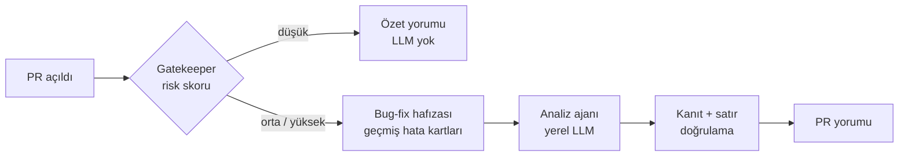

# 🛡️ Aegis

**Risk odaklı ve hafızalı PR inceleme sistemi.**

Aegis bir Pull Request açıldığında üç adımda çalışır:

1. Değişikliğin riskini **klasik bir ML modeliyle** ölçer ve düşük riskli PR'ları LLM'e hiç göndermez.
2. Riskli PR'ları incelerken LLM'e **reponun kendi geçmiş hatalarını** hatırlatır.
3. Bulguları diff'e karşı doğrular ve PR'a yorum olarak yazar; PR'ı asla bloklamaz. Tüm modeller **yerelde** (Ollama) çalışır, kod dışarı çıkmaz.

> **Durum:** Faz 0–4 tamam; değerlendirmede LLM'siz sonuçlar hazır, LLM deneyleri koşuluyor · **Dil:** Python · **Kullanım:** GitHub Action + CLI · **Demo:** [httpie fork'u](https://github.com/mhmtemnbgr1/cli/pulls)

---

## Neden?

| Mevcut yaklaşım | Eksik kalan | Aegis'in cevabı |
| --- | --- | --- |
| LLM PR botları (PR-Agent, CodeRabbit, Copilot review) | Her PR'a LLM çağırır; repo geçmişini bilmez; kodu buluta gönderir | **Gatekeeper** düşük riskli PR'ları eler · **Bug-fix hafızası** geçmişi hatırlatır · **Yerel model** kodu dışarı çıkarmaz |
| JIT hata tahmini (SZZ + Git metrikleri + RF/XGBoost) | "%75 hatalı" der ama hatanın ne olduğunu söylemez, düzeltme önermez | Tahmin sonucunu LLM için bir **maliyet kapısı** olarak kullanır ve bir **aksiyona** dönüştürür |

## Nasıl Çalışır?



Demo fork'undaki [PR #3](https://github.com/mhmtemnbgr1/cli/pull/3)'e Aegis'in yazdığı gerçek yorum (httpie'nin 2023'te düzelttiği bir hata bilerek geri getirildi; GitHub runner'ında Ollama olmadığı için LLM analizi kapalı):

> **🛡️ Aegis — Risk: 0.02 (orta)**
> Neden: değişen dosyalarda geçmişte 4 hata düzeltilmiş (riski artırıyor) · bu dosyalar daha önce 31 commit'te değiştirilmiş (riski artırıyor) · model: mhmtemnbgr1__cli/lr-none
>
> 🧠 **Bu kodda geçmişte düzeltilmiş benzer hatalar:**
> - `BC-44d3cff03f` 2023-05-19 — Fix log level display on newer Python · `httpie.context.Environment.config`
> - …

Hafıza, geri getirilen hatanın eski düzeltmesini ilk sırada gösteriyor. Ollama'ya erişilebilen bir runner'da LLM bulguları da satır yorumu olarak eklenir.

## Fazlar

| Faz | İçerik | Durum |
| --- | --- | --- |
| 0 | Altyapı: CI, tip kontrolü, geliştirme ortamı | ✅ |
| 1 | **Uçtan uca iskelet:** sezgisel gatekeeper, LLM çağrısı, kanıt doğrulama, PR yorumu, GitHub Action | ✅ |
| 2 | Repo madenciliği: PyDriller, fix-commit tespiti, SZZ, Kamei metrikleri, artımlı tarama | ✅ |
| 3 | ML gatekeeper: LR / RF / LightGBM, zaman sıralı doğrulama, kalibrasyon, açıklamalar | ✅ |
| 4 | Bug-fix hafızası: hata kartları, hibrit arama, analiz ajanına bağlam, durum arşivi | ✅ |
| ~~5~~ | ~~Patch ve doğrulama~~ | Kapsam dışı (gelecek çalışma) |
| 6 | Değerlendirme: RQ1 (gatekeeper) ve RQ2 (hafıza) | ✅ (LLM'siz ve yerel Ollama ile LLM'li deneyler) |
| 7 | Sunum ve belgeler: [docs/presentation.md](docs/presentation.md) | Sürüyor |

Her faz bir önceki fazın çalışan sistemini derinleştirir. Ayrıntılı görevler [TODO.md](TODO.md) dosyasında ve [GitHub Issues](https://github.com/mhmtemnbgr1/Aegis/issues) altında.

## Sonuçlar

Altı açık kaynak Python projesinin (black, luigi, sanic, scrapy, tornado, tqdm) tüm geçmişi üzerinde, zaman sıralı ve sızıntısız değerlendirme:

| Ölçü | Sonuç |
| --- | --- |
| PR'ların %40'ı LLM'e gidince yakalanan hatalı PR | **%82** (sezgisel kural %75, rastgele %40; fark anlamlı) |
| Maliyet odaklı ayar | PR'ların **%58**'i LLM'e hiç gitmiyor, hatalı PR'ların %82'si yine yakalanıyor |
| Hafıza sinyalinin katkısı (dar bütçe) | +4 puan; aynı dağılımlı ama bilgisiz plasebo kazanç getirmiyor |
| Hafıza getirme (hibrit) | İlgili eski hata vakaların %47'sinde ilk sırada, %64'ünde ilk 5'te |
| Gerçek PR'larda süre (D4) | Medyan 0,02 sn, p95 4,3 sn; hiçbir PR engellenmedi |
| Ucuz LLM triage (Qwen2.5-Coder 1.5B, %40 LLM payı) | Hatalı PR'ların %53'ü (risk modeli %85, sezgisel %74; ikisi de anlamlı derecede iyi) |
| Hafızalı LLM incelemesi (Qwen2.5-Coder 7B) | Hafıza tespiti artırmadı: hafızasız %45, hibrit %37, plasebo %41 (revert seti; fark anlamlı değil) |

Tüm tablolar, güven aralıkları ve testler [docs/results.md](docs/results.md) içinde (`uv run python eval/results.py` ile yeniden üretilir). LLM'li deneyler (RQ1 ucuz LLM triage, RQ2 hafızalı inceleme) [docs/llm-experiments.md](docs/llm-experiments.md) kılavuzuyla yerel Ollama'da koşuldu. Bilinen sınırlama: SZZ etiketlerinin elle kontrolde yalnızca %19–31'i doğru; RQ2 bu yüzden hatalı örnekler için SZZ yerine tersine çevrilmiş gerçek düzeltmeleri kullanır ([eval/README.md](eval/README.md)).

## Kullanım

### Yerelde

```bash
aegis score  --base main          # yalnızca risk skoru
aegis review --base main          # gatekeeper + analiz ajanı; sonuç terminale
aegis review --base main --no-llm # LLM'siz, yalnızca deterministik kurallar
```

Eğitilmiş risk modeli (Faz 2–3):

```bash
aegis mine .                      # geçmişi tara, fix'leri bul, SZZ ve Kamei metrikleri
aegis dataset                     # taranan repolardan D1
aegis train --repo <slug>         # LR / RF / LightGBM; kalibre, zaman sıralı
aegis score main..HEAD --model .aegis/models/<slug>/lr-none.pkl   # skor, bant, açıklama
```

`[gatekeeper] mode = "model"` ile `aegis score` modeli kendisi bulur; model ya da madencilik geçmişi yoksa sezgisel kurala döner.

Bug-fix hafızası (Faz 4):

```bash
aegis index .                     # hata kartları (artımlı) ve vektör indeksi
aegis dataset                     # D1'i hafıza sinyaliyle yeniden üret (index'ten sonra)
```

Durum arşivi (GitHub Action için):

```bash
aegis publish-state .             # veri, model ve kartları Release asset'i olarak yükle (GITHUB_TOKEN)
aegis publish-state . --out s.tar.gz   # yalnızca yerel arşiv
```

Action, arşivi önce `actions/cache`'ten, yoksa Release'ten alır (`aegis fetch-state`). Arşiv yoksa sezgisel kuralla ve hafızasız çalışır.

Bu repoda `.github/workflows/main-state.yml`, `main`'e push sonrası yeni commit'leri artımlı işler, hata kartlarını günceller ve durum Release/cache'ini yazar. `.github/workflows/weekly-train.yml` her pazartesi sürümlenmiş D1 üzerinden genel modeli yeniden eğitip Release asset'ini günceller. İkisi de `contents: write` izni kullanır.

### GitHub Action

`.github/workflows/aegis.yml`:

```yaml
name: Aegis
on:
  pull_request:            # pull_request_target KULLANMAYIN

permissions:
  contents: read
  pull-requests: write     # özet ve satır yorumları
  checks: write            # check run

jobs:
  review:
    runs-on: ubuntu-latest
    steps:
      - uses: actions/checkout@v4
        with:
          fetch-depth: 0   # base...head diff'i için tam geçmiş
      - uses: mhmtemnbgr1/Aegis@main
        with:
          ollama-host: ${{ vars.OLLAMA_HOST }}   # Ollama'lı self-hosted runner / sunucu
```

- Yapılandırma (`.aegis.toml`) ve `.aegisignore` **taban dalın** sürümünden okunur; PR kendi incelemesini gevşetemez.
- Yalnızca **yerel model (Ollama)** kullanılır; bulut LLM'i ve API anahtarı yoktur. `ollama-host` verilmezse (GitHub'ın barındırılan runner'larında Ollama yoktur) LLM adımı uyarısız atlanır ve inceleme gatekeeper ile deterministik kurallarla sürer.
- Aegis PR'ı **asla bloklamaz**: kendi hatasında check run `neutral` olur ve özet yorumunda uyarı bırakılır.
- Her çalıştırmanın metrikleri `aegis-runs-*` artifact'ı olarak yüklenir.

Tüm seçenekler: [`action.yml`](action.yml) · [`.aegis.toml.example`](.aegis.toml.example)

## Dokümanlar

| Dosya | İçerik |
| --- | --- |
| [docs/rad.md](docs/rad.md) | Gereksinim Analiz Dokümanı (RAD): kapsam, hedefler, FR/NFR, senaryolar, UML modelleri, arayüz taslakları |
| [docs/setup.md](docs/setup.md) | Geliştirme ortamı: uv, Ollama |
| [docs/architecture.md](docs/architecture.md) | Gereksinimler, katman ayrıntıları, şemalar, modüller, teknoloji yığını, güvenlik |
| [docs/presentation.md](docs/presentation.md) | Proje özeti: katkılar, araştırma soruları, değerlendirme planı, demo, sık sorulan sorular, kaynakça |
| [docs/results.md](docs/results.md) | LLM'siz sonuçlar: veri, etiket kalitesi, risk modeli, maliyet–recall eğrisi, hafıza, gerçek PR'lar |
| [docs/llm-experiments.md](docs/llm-experiments.md) | LLM deneylerini koşturma kılavuzu |
| [docs/mining-schema.md](docs/mining-schema.md) | Madencilik çıktılarının şeması, SZZ ve etiket kalitesi |
| [eval/README.md](eval/README.md) | Veri setleri (D1, D2, D4) ve değerlendirme betikleri |
| [docs/target-repos.md](docs/target-repos.md) | Eğitim ve değerlendirmede kullanılan repolar |
| [docs/ideas.md](docs/ideas.md) | Kapsam dışı fikirler |

## Geliştirme

```bash
uv sync --all-extras        # Ollama SDK'sı dahil
uv run pre-commit install   # commit öncesi ruff, ruff-format, mypy
uv run ruff check .
uv run mypy
uv run pytest
```

## Lisans

[MIT](LICENSE)
