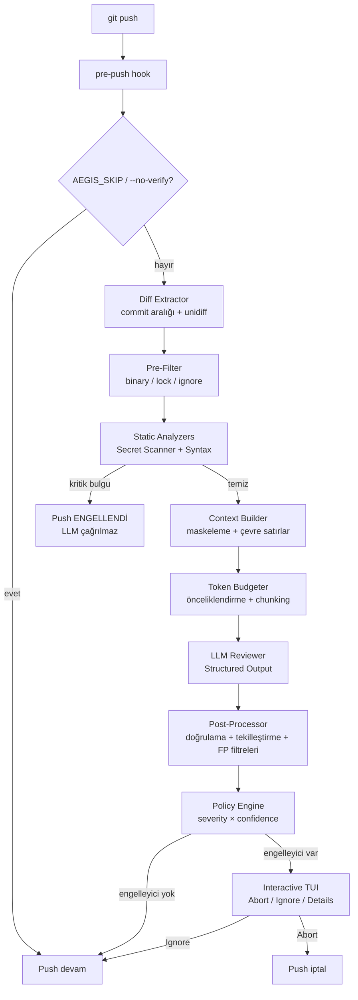
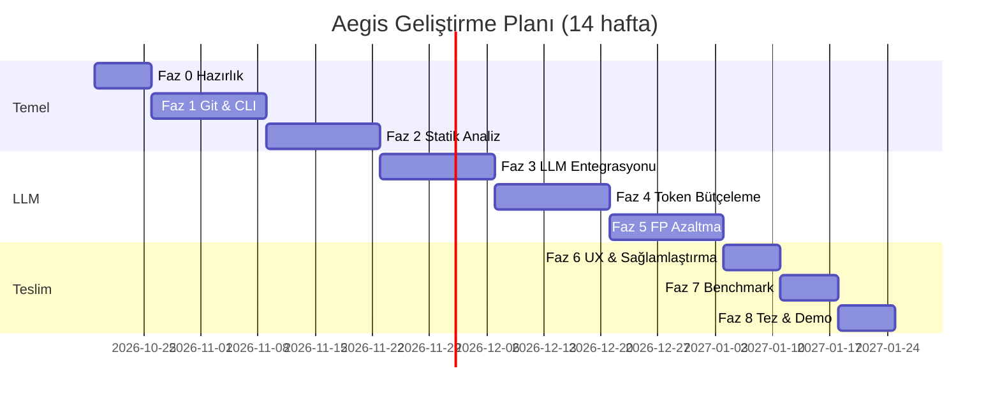

# 🛡️ Aegis — LLM Destekli Pre-Push Kod İnceleme Aracı

> Geliştiricinin `git push` komutunu çalıştırdığı anda devreye giren, değişiklikleri (diff) önce yerel statik kontrollerden, ardından bir LLM'den geçirerek **yalnızca gerçekten kritik** sorunlarda push'u durduran bir CLI aracı.

**Durum:** Planlama aşaması · **Tür:** Bitirme Projesi · **Hedef diller (v1):** Python, TypeScript

---

## İçindekiler

1. [Problem ve Amaç](#1-problem-ve-amaç)
2. [Kapsam](#2-kapsam)
3. [Gereksinimler](#3-gereksinimler)
4. [Mimari](#4-mimari)
5. [Teknoloji Yığını](#5-teknoloji-yığını)
6. [Faz Faz Geliştirme Planı](#6-faz-faz-geliştirme-planı)
7. [Değerlendirme ve Benchmark](#7-değerlendirme-ve-benchmark)
8. [Maliyet Planı](#8-maliyet-planı)
9. [Riskler ve Önlemler](#9-riskler-ve-önlemler)
10. [Dizin Yapısı](#10-dizin-yapısı)
11. [Yapılandırma Örneği](#11-yapılandırma-örneği)
12. [Ekip ve Çalışma Düzeni](#12-ekip-ve-çalışma-düzeni)

---

## 1. Problem ve Amaç

Kod incelemesi (code review) genellikle push/PR **sonrasında** yapılır. Bu durumda:

- Sızdırılmış şifre/token gibi hatalar uzak depoya (remote) çoktan ulaşmış olur.
- Basit ama kritik mantık hataları CI'a veya insan incelemesine kadar fark edilmez.
- İnceleyicinin zamanı, otomatik yakalanabilecek sorunlarla harcanır.

**Aegis'in amacı:** Sorunları push anında, geliştiricinin kendi makinesinde yakalamak.

- Ucuz ve deterministik kontroller (regex, parser) → **önce ve yerelde**.
- Pahalı ve olasılıksal analiz (LLM) → **yalnızca iş mantığı ve mimari** için.
- Push'u engelleme kararı → **sadece yüksek güvenli, kritik bulgularda**.

### Başarı Kriterleri (Tez için ölçülebilir hedefler)

| Metrik | Hedef |
| --- | --- |
| Secret tespiti recall (benchmark seti) | ≥ %95 |
| Engelleyici (blocking) bulguların precision değeri | ≥ %80 |
| Ortalama push gecikmesi (≤ 10 dosya, bulut model) | ≤ 15 sn |
| Push başına ortalama maliyet (bulut, küçük model) | ≤ 0,01 $ |
| Statik ön filtre süresi | ≤ 1 sn |

---

## 2. Kapsam

### Kapsam İçi (v1)

- `pre-push` git hook kurulumu/kaldırılması (`aegis install` / `aegis uninstall`)
- Push edilecek commit aralığının diff'ini çıkarma ve ayrıştırma
- Ön filtreleme: binary, lock, minified, üretilmiş (generated) dosyaları eleme
- Secret scanner: API anahtarları, token'lar, private key'ler, yüksek entropili string'ler
- Basit syntax kontrolü (Python ve TypeScript)
- LLM ile yapılandırılmış (JSON Schema) inceleme çıktısı
- Token bütçeleme, dosya önceliklendirme ve diff parçalama (chunking)
- Önem derecesi (severity) + güven (confidence) tabanlı engelleme politikası
- Etkileşimli terminal arayüzü: `[A] Abort` / `[I] Ignore and push` / `[D] Details`
- Bypass: `git push --no-verify` ve `AEGIS_SKIP=1`
- Birden fazla LLM sağlayıcısı: Ollama (yerel), Gemini, OpenAI, Anthropic
- Benchmark/değerlendirme altyapısı

### Kapsam Dışı (bilinçli olarak)

- Python ve TypeScript dışındaki diller (mimari genişletilebilir olacak ama v1'de test edilmeyecek)
- IDE eklentileri, web arayüzü
- Sunucu tarafı (server-side) hook / GitHub App
- Kodu otomatik düzeltme (auto-fix)
- Tüm depo üzerinde (repo-wide) semantik indeksleme / RAG

> ⚠️ En büyük risk finansal değil **kapsam kontrolüdür (scope creep)**. Yeni özellik fikirleri `docs/ideas.md` dosyasına yazılır, v1 bitmeden uygulanmaz.

---

## 3. Gereksinimler

### 3.1 Fonksiyonel Gereksinimler

| ID | Gereksinim | Öncelik |
| --- | --- | --- |
| FR-01 | `aegis install` komutu, mevcut depoya `pre-push` hook'u kurar; var olan hook'u yedekler. | Must |
| FR-02 | Hook, git'in stdin'den verdiği `<local ref> <local sha> <remote ref> <remote sha>` satırlarını okuyup push edilecek commit aralığını belirler. | Must |
| FR-03 | Yeni branch push'unda (remote sha = `000…0`) karşılaştırma tabanı olarak varsayılan branch ile merge-base kullanılır. | Must |
| FR-04 | Diff, dosya ve hunk seviyesinde ayrıştırılır (eklenen/silinen satırlar, satır numaraları). | Must |
| FR-05 | Binary, lock (`package-lock.json`, `poetry.lock`, `uv.lock` vb.), minified ve `.aegisignore` ile eşleşen dosyalar elenir. | Must |
| FR-06 | Secret scanner, eklenen satırlarda bilinen token kalıplarını ve yüksek entropili string'leri arar; bulgu varsa **LLM'e gitmeden** push'u durdurur. | Must |
| FR-07 | Secret içeren satırlar LLM'e **asla** gönderilmez (maskelenir). | Must |
| FR-08 | Python (`ast`) ve TypeScript (tree-sitter) dosyalarında syntax hatası yerelde yakalanır. | Should |
| FR-09 | LLM çıktısı tanımlı JSON Schema'ya uymak zorundadır; uymayan yanıt bir kez yeniden denenir, yine uymazsa inceleme "uyarı" olarak atlanır (push engellenmez). | Must |
| FR-10 | Toplam diff token bütçesini aşarsa dosyalar önceliklendirilir ve parçalara bölünür. | Must |
| FR-11 | Her bulgu: dosya, satır, kategori, severity (`critical/high/medium/low/info`), confidence (0–1), açıklama ve öneri içerir. | Must |
| FR-12 | Push yalnızca politika eşiğini geçen bulgularda engellenir (varsayılan: `severity=critical` ve `confidence ≥ 0.8`). | Must |
| FR-13 | Kullanıcıya etkileşimli seçim sunulur: Abort / Ignore and push / Details. TTY yoksa (CI vb.) etkileşimsiz moda geçilir. | Must |
| FR-14 | `--no-verify` ve `AEGIS_SKIP=1` ile inceleme tamamen atlanabilir; atlamalar yerel log'a yazılır. | Must |
| FR-15 | Sağlayıcı ve model `.aegis.toml` ile seçilir; API anahtarları yalnızca ortam değişkeninden okunur. | Must |
| FR-16 | Her çalıştırmanın sonucu (süre, token, maliyet, bulgular) `.aegis/history.jsonl` dosyasına yazılır. | Should |
| FR-17 | `aegis review --staged` / `aegis review <range>` ile hook olmadan manuel inceleme yapılabilir. | Should |
| FR-18 | Aynı diff için LLM yanıtı önbelleğe alınır (hash tabanlı cache); tekrar push'ta yeniden ücret ödenmez. | Could |
| FR-19 | Kullanıcı bir bulguyu "yanlış pozitif" olarak işaretleyebilir (`aegis dismiss <id>`); bu geri bildirim değerlendirmede kullanılır. | Could |

### 3.2 Fonksiyonel Olmayan Gereksinimler

| ID | Gereksinim |
| --- | --- |
| NFR-01 | **Performans:** Statik aşama < 1 sn; LLM aşaması varsayılan 30 sn zaman aşımına sahip. Zaman aşımında push engellenmez (fail-open). |
| NFR-02 | **Güvenilirlik:** Aracın kendi hatası (ağ yok, API hatası, parse hatası) push'u asla engellemez; uyarı basılır. |
| NFR-03 | **Gizlilik:** Kod yalnızca kullanıcının seçtiği sağlayıcıya gider. `provider = "ollama"` ile tamamen çevrimdışı çalışır. |
| NFR-04 | **Taşınabilirlik:** Windows (Git Bash), macOS ve Linux'ta çalışır. |
| NFR-05 | **Kurulum:** Tek komutla kurulum (`pipx install aegis-review` veya `uv tool install`). |
| NFR-06 | **Test edilebilirlik:** Çekirdek modüllerde ≥ %80 test kapsamı; LLM çağrıları mock'lanabilir. |
| NFR-07 | **Genişletilebilirlik:** Yeni dil, yeni sağlayıcı ve yeni statik kural eklemek tek bir arayüzü (interface/protocol) uygulamakla mümkün olmalı. |

---

## 4. Mimari

### 4.1 Akış



### 4.2 Modüller

| Modül | Sorumluluk |
| --- | --- |
| `cli` | Komutlar: `install`, `uninstall`, `review`, `config`, `dismiss`, `stats` |
| `git` | Hook stdin'ini okuma, commit aralığını bulma, `git diff` çalıştırma (subprocess) |
| `diff` | Unified diff'i dosya/hunk/satır modeline çevirme |
| `filters` | Dosya eleme kuralları (uzantı, boyut, glob, generated header tespiti) |
| `static` | `SecretScanner`, `SyntaxChecker` — her biri `Analyzer` protokolünü uygular |
| `context` | Hunk etrafına bağlam satırları ekleme, secret maskeleme, dil tespiti |
| `budget` | Token sayımı, dosya önceliklendirme, chunk oluşturma |
| `llm` | Sağlayıcı adaptörleri (Ollama, Gemini, OpenAI, Anthropic), retry, timeout, cache |
| `prompts` | Sistem prompt'u, few-shot örnekler, JSON Schema |
| `postprocess` | Şema doğrulama, satır numarası doğrulama, tekilleştirme, FP sezgileri |
| `policy` | Engelleme kararı |
| `ui` | Rich tabanlı terminal çıktısı ve etkileşimli seçim |
| `telemetry` | Yerel `history.jsonl` kaydı (dışarı veri göndermez) |

### 4.3 LLM Çıktı Şeması (taslak)

```json
{
  "type": "object",
  "required": ["findings", "summary"],
  "properties": {
    "summary": { "type": "string", "maxLength": 400 },
    "findings": {
      "type": "array",
      "items": {
        "type": "object",
        "required": ["file", "line", "category", "severity", "confidence", "title", "explanation"],
        "properties": {
          "file":        { "type": "string" },
          "line":        { "type": "integer", "minimum": 1 },
          "category":    { "enum": ["bug", "security", "concurrency", "resource-leak", "error-handling", "api-misuse", "performance", "maintainability"] },
          "severity":    { "enum": ["critical", "high", "medium", "low", "info"] },
          "confidence":  { "type": "number", "minimum": 0, "maximum": 1 },
          "title":       { "type": "string", "maxLength": 120 },
          "explanation": { "type": "string" },
          "suggestion":  { "type": "string" },
          "evidence":    { "type": "string", "description": "Bulgunun dayandığı diff satırının birebir alıntısı" }
        }
      }
    }
  }
}
```

> `evidence` alanı kritik bir FP önlemidir: model, diff'te **birebir bulunmayan** bir satıra dayanıyorsa bulgu otomatik düşürülür (halüsinasyon filtresi).

---

## 5. Teknoloji Yığını

### 5.1 Ana Dil: **Python 3.12+**

**Neden Python?** LLM SDK'ları, tokenizer'lar ve değerlendirme araçları en olgun halde Python'da; ekip prototipi hızlı çıkarabilir; hedef dillerden biri olduğu için kendi kodumuzu da (dogfooding) inceleyebiliriz.

> Alternatif: **Go** (tek binary, hızlı başlangıç). Hook başlangıç süresi kritik hale gelirse v2'de CLI çekirdeği Go'ya taşınabilir. v1 için Python seçildi.

### 5.2 Kütüphaneler

| Alan | Teknoloji | Kullanım Amacı |
| --- | --- | --- |
| Paket/ortam yönetimi | **uv** | Bağımlılık yönetimi, sanal ortam, `uv tool install` ile dağıtım |
| CLI | **Typer** | Komut tanımları, argüman ayrıştırma |
| Terminal UI | **Rich** | Renkli tablolar, syntax highlight, spinner, etkileşimli prompt |
| Veri modelleri | **Pydantic v2** | Bulgu modelleri, config doğrulama, JSON Schema üretimi |
| Config | **tomllib** (stdlib) | `.aegis.toml` okuma |
| Diff ayrıştırma | **unidiff** | Unified diff → PatchSet |
| Git erişimi | **subprocess** (`git` CLI) | GitPython yerine doğrudan CLI: daha az bağımlılık, daha öngörülebilir |
| Syntax/AST | **ast** (stdlib), **tree-sitter** + `tree-sitter-typescript` | Python ve TS syntax kontrolü, fonksiyon sınırı tespiti (akıllı chunking) |
| Secret tespiti | Kendi regex kural seti + **Shannon entropisi**; referans: gitleaks / detect-secrets kural setleri | Token, anahtar, private key yakalama |
| HTTP | **httpx** | Sağlayıcı API çağrıları, timeout, retry |
| LLM SDK'ları | `openai`, `anthropic`, `google-genai`, `ollama` | Sağlayıcı adaptörleri (tek bir `LLMProvider` protokolü arkasında) |
| Token sayımı | **tiktoken** (+ sağlayıcıya göre yaklaşık oran) | Bütçe hesaplama |
| Retry | **tenacity** | Exponential backoff |
| Cache | **diskcache** veya SQLite | Diff hash → LLM yanıtı |
| Test | **pytest**, `pytest-cov`, `pytest-mock`, **syrupy** (snapshot) | Birim/entegrasyon testleri |
| Kalite | **ruff** (lint+format), **mypy** (strict), **pre-commit** | Kod kalitesi |
| CI | **GitHub Actions** | Test, lint, tip kontrolü (Windows + Ubuntu + macOS matrisi) |
| Değerlendirme | **pandas**, **matplotlib** | Benchmark sonuç tabloları ve tez grafikleri |
| Dokümantasyon | Markdown + **Mermaid** | Mimari diyagramlar |

### 5.3 LLM Modelleri

| Aşama | Model | Maliyet |
| --- | --- | --- |
| Yerel geliştirme | **Ollama** + `qwen2.5-coder:7b` veya `deepseek-coder:6.7b` | 0 TL |
| Günlük geliştirme / entegrasyon | **Google AI Studio** — Gemini Flash ailesi (ücretsiz kota) | 0 TL |
| Final benchmark ve jüri demosu | OpenAI `gpt-4o-mini` sınıfı, Anthropic Haiku sınıfı küçük modeller | ~5–10 $ |

> Model adları `.aegis.toml` içinde parametredir; kod hiçbir modele sabit bağlı değildir. Tezde en az **3 model** karşılaştırılacaktır (1 yerel + 2 bulut).

---

## 6. Faz Faz Geliştirme Planı

Toplam süre: **~14 hafta**. Her faz sonunda çalışan bir sürüm (`v0.x`) etiketlenir.

---

### Faz 0 — Hazırlık ve İskelet (1. hafta)

**Amaç:** Herkesin aynı ortamda çalışabildiği, CI'ı yeşil boş bir proje.

- [ ] Depo yapısı, `pyproject.toml`, `uv` ortamı
- [ ] ruff, mypy, pytest, pre-commit kurulumu
- [ ] GitHub Actions: lint + test (3 işletim sistemi)
- [ ] Branch stratejisi (`main` korumalı, `feat/*` branch'leri, PR zorunlu)
- [ ] Issue/PR şablonları, GitHub Projects panosu
- [ ] Ollama kurulumu ve Gemini API anahtarı (her ekip üyesi için)
- [ ] `aegis --version` çalışıyor

**Çıktı:** `v0.0.1` · **Kabul kriteri:** CI yeşil, `uv run aegis --help` çalışıyor.

---

### Faz 1 — Git & CLI Entegrasyonu (2.–3. hafta) · Zorluk 3/10

**Amaç:** Hook kurulsun, push edilecek değişiklikler doğru şekilde çıkarılsın.

- [ ] `aegis install` / `uninstall` (mevcut hook'u `pre-push.aegis-backup` olarak yedekle)
- [ ] Hook script'i: POSIX sh, Windows Git Bash uyumlu, `aegis hook pre-push "$@"` çağırır
- [ ] stdin'den ref satırlarını okuma; birden fazla ref push'u
- [ ] Commit aralığı hesaplama: normal push, yeni branch, silinen branch (atla), force push
- [ ] `git diff --no-color --unified=3 <base>..<head>` çıktısını `unidiff` ile modele dönüştürme
- [ ] Rename, binary ve silinen dosyaların doğru işlenmesi
- [ ] `aegis review --staged` ve `aegis review <range>` manuel komutları
- [ ] Bypass: `--no-verify` (git yerleşik) ve `AEGIS_SKIP=1`

**Testler:** Geçici git depoları oluşturan pytest fixture'ları (`tmp_path` + gerçek `git`) ile her push senaryosu.

**Çıktı:** `v0.1.0` — hook kuruluyor ve diff'i ekrana basıyor.

---

### Faz 2 — Ön Filtreleme & Statik Analiz (4.–5. hafta) · Zorluk 4/10

**Amaç:** Ucuz, deterministik ve hızlı kontroller; kritik sızıntıda push'u **anında** kes.

- [ ] Dosya filtreleri: binary tespiti, lock dosyaları, `*.min.js`, `dist/`, `build/`, `node_modules/`, üretilmiş dosya başlıkları (`// Code generated`, `@generated`)
- [ ] `.aegisignore` (gitignore sözdizimi, `pathspec` kütüphanesi)
- [ ] Boyut limiti (ör. tek dosyada > 1500 değişen satır → LLM'e gönderme, uyar)
- [ ] **Secret Scanner:**
  - [ ] Kural seti: AWS, GCP, Azure, GitHub, GitLab, Slack, Stripe, OpenAI/Anthropic anahtarları, JWT, private key blokları, `.env` atamaları, bağlantı dizeleri (DB URL içinde şifre)
  - [ ] Shannon entropisi (base64 ve hex için ayrı eşik)
  - [ ] Allowlist: test fixture'ları, `example`, `dummy`, `xxx` placeholder'ları; satır içi `# aegis:allow`
  - [ ] Yalnızca **eklenen** satırlar taranır
- [ ] **Syntax Checker:** Python için `ast.parse`, TS için tree-sitter hata düğümleri
- [ ] Bulguların ortak `Finding` modeline dönüştürülmesi
- [ ] Secret bulunan satırların maskelenmesi (`sk-****`)

**Testler:** Her kural için pozitif + negatif örnek; ~200 satırlık sentetik secret veri seti.

**Çıktı:** `v0.2.0` — Aegis, LLM olmadan bile secret sızıntısını engelleyen kullanılabilir bir araç.

---

### Faz 3 — LLM Entegrasyonu & Prompt Mühendisliği (6.–7. hafta) · Zorluk 5/10

**Amaç:** Diff'i LLM'e gönder, şemaya uygun ve güvenilir bulgular al.

- [ ] `LLMProvider` protokolü: `review(request) -> ReviewResponse`
- [ ] Adaptörler: Ollama, Gemini, OpenAI, Anthropic
- [ ] Structured Output: sağlayıcının yerel JSON Schema / tool-use desteği; desteklemeyenlerde (Ollama) `format=json` + Pydantic doğrulama
- [ ] Geçersiz JSON → 1 kez "düzelt" retry → yine olmazsa fail-open
- [ ] Timeout, exponential backoff (tenacity), rate-limit (429) yönetimi
- [ ] Prompt tasarımı:
  - [ ] Sistem prompt'u: rol, **neyi raporlamamalı** listesi (stil, isimlendirme, yorum eksikliği, "daha iyi olabilir" önerileri)
  - [ ] Severity tanımları ve somut örnekler
  - [ ] Dil bazlı ipuçları (Python: mutable default arg, bare except; TS: `any`, unhandled promise, `==`)
  - [ ] 2–3 few-shot örnek (biri "bulgu yok" örneği — modelin her şeye hata bulma eğilimini kırmak için)
- [ ] Context Builder: hunk + çevre satırlar + dosya yolu + dil
- [ ] Prompt'ların versiyonlanması (`prompts/v1/…`) — benchmark'ta prompt versiyonları karşılaştırılacak
- [ ] Diff hash tabanlı yanıt cache'i

**Çıktı:** `v0.3.0` — küçük diff'lerde uçtan uca LLM incelemesi çalışıyor.

---

### Faz 4 — Token Bütçeleme & Büyük Diff'ler (8.–9. hafta) · Zorluk 7/10

**Amaç:** 40 dosyalık bir push'ta bile maliyeti ve süreyi kontrol altında tutmak.

- [ ] Token sayacı (tiktoken + sağlayıcı bazlı düzeltme katsayısı)
- [ ] Bütçe parametreleri: `max_input_tokens_per_request`, `max_total_tokens_per_push`, `max_requests_per_push`
- [ ] **Dosya önceliklendirme skoru:**
  - Kaynak kod > test > config > doküman
  - Riskli yollar yüksek puan (`auth`, `payment`, `crypto`, `db`, `api`, `security`)
  - Değişen satır sayısı (çok küçük ve çok büyük değişiklik düşük puan)
  - Eklenen satır oranı (salt silmeler düşük puan)
  - Riskli API kullanımı (`eval`, `exec`, `subprocess`, `innerHTML`, SQL string birleştirme)
- [ ] **Chunking stratejileri:**
  1. Dosya bazlı gruplama (bin-packing ile bütçeye sığdırma)
  2. Büyük dosyalarda hunk bazlı bölme
  3. tree-sitter ile fonksiyon/sınıf sınırına göre bölme (bir fonksiyonu ortadan kesmemek için)
- [ ] Paralel chunk istekleri (`asyncio`, eşzamanlılık limiti)
- [ ] Bütçe dışı kalan dosyaların kullanıcıya raporlanması ("12 dosya incelenmedi")
- [ ] Bulgu birleştirme ve tekilleştirme (chunk'lar arası)

**Deney:** Aynı büyük diff'te (a) kesme, (b) hunk chunking, (c) AST chunking — maliyet, süre ve bulgu kalitesi karşılaştırması. **Tezin ana deneylerinden biri.**

**Çıktı:** `v0.4.0`

---

### Faz 5 — Yanlış Pozitif (False Positive) Azaltma (10.–11. hafta) · Zorluk 8/10

**Amaç:** Aracı "her şeye itiraz eden" bir araç olmaktan çıkarmak. **Projenin en kritik fazı.**

- [ ] **Policy Engine:** varsayılan olarak yalnızca `critical` + `confidence ≥ 0.8` engeller; `high` uyarı verir, altı bilgi amaçlı (veya gizli)
- [ ] **Kanıt doğrulama:** `evidence` diff'te birebir yoksa bulgu düşürülür
- [ ] **Satır doğrulama:** bulgu satırı, değişen satırlara (veya ±N bağlamına) denk gelmiyorsa düşürülür — sadece değişen kod eleştirilir
- [ ] **Kategori filtresi:** stil/isimlendirme gibi kategoriler hiçbir zaman engelleyici olamaz
- [ ] **Self-consistency (opsiyonel):** kritik bulgular için ikinci, odaklı bir doğrulama çağrısı ("Bu bulgu gerçekten bir hata mı? Evet/Hayır + gerekçe"); yalnızca engelleme adayı bulgularda çalışır, maliyet sınırlı
- [ ] **Ensemble (deneysel):** iki farklı modelin hemfikir olduğu kritik bulgular
- [ ] Kullanıcı geri bildirimi: `aegis dismiss <id>`, `.aegis/feedback.jsonl`
- [ ] Prompt iterasyonları — her iterasyon benchmark üzerinde precision/recall ile ölçülür

**Deney:** Policy eşikleri ve doğrulama adımlarının precision/recall üzerindeki etkisi (ablation study).

**Çıktı:** `v0.5.0`

---

### Faz 6 — Kullanıcı Deneyimi & Sağlamlaştırma (12. hafta)

- [ ] Rich ile bulgu tablosu, syntax-highlight edilmiş kod parçası, özet satırı
- [ ] Etkileşimli seçim: `[A] Abort push` · `[I] Ignore and push anyway` · `[D] Show details`
- [ ] TTY yoksa etkileşimsiz mod (`--ci` / `AEGIS_NONINTERACTIVE=1`)
- [ ] `aegis stats`: toplam push, engellenen, atlanan, ortalama süre/maliyet
- [ ] `aegis config init`: etkileşimli config oluşturucu
- [ ] Hata durumlarında açıklayıcı mesajlar (ağ yok, anahtar yok, model yok)
- [ ] Windows Git Bash ve PowerShell üzerinden uçtan uca test
- [ ] Paketleme: `uv build`, PyPI (TestPyPI) yayını
- [ ] Kullanıcı dokümantasyonu: kurulum, yapılandırma, SSS

**Çıktı:** `v1.0.0-rc`

---

### Faz 7 — Değerlendirme & Benchmark (13. hafta)

Ayrıntılar [Bölüm 7](#7-değerlendirme-ve-benchmark)'de.

- [ ] Benchmark veri setinin tamamlanması ve etiketlenmesi
- [ ] Tüm model × prompt × chunking kombinasyonlarının koşturulması
- [ ] Sonuç tabloları ve grafikler (`eval/reports/`)
- [ ] Ekip içi kullanım (dogfooding) verilerinin toplanması

**Çıktı:** `v1.0.0` + değerlendirme raporu

---

### Faz 8 — Tez Yazımı & Jüri Demosu (14. hafta)

- [ ] Tez metni: problem, ilgili çalışmalar (gitleaks, Semgrep, CodeRabbit vb. araçlarla karşılaştırma), mimari, deneyler, sonuçlar, kısıtlar
- [ ] Demo senaryosu (canlı, ~5 dk):
  1. Secret içeren push → LLM'e gitmeden anında engellenir
  2. Temiz push → saniyeler içinde geçer
  3. Kritik mantık hatası içeren push → engellenir, açıklama gösterilir
  4. "Acil hotfix" → `Ignore and push` / `--no-verify`
  5. Ollama ile tamamen çevrimdışı çalışma
- [ ] Demo için kayıtlı yedek video (internet/API sorununa karşı)
- [ ] Olası jüri soruları ve cevapları (`docs/jury-faq.md`)

---

### Zaman Çizelgesi Özeti



> Benchmark veri seti **Faz 2'den itibaren paralel olarak** büyütülür; Faz 7'ye bırakılmaz.

---

## 7. Değerlendirme ve Benchmark

### 7.1 Veri Seti

| Kaynak | Açıklama | Hedef Boyut |
| --- | --- | --- |
| Sentetik secret seti | Gerçekçi ama sahte anahtarlar + yanıltıcı negatifler | ~300 örnek |
| Enjekte edilmiş hatalar | Gerçek açık kaynak Python/TS projelerine elle eklenen bilinen hatalar (off-by-one, null check eksikliği, SQL injection, await unutma, kaynak sızıntısı vb.) | ~100 diff |
| Gerçek düzeltme commit'leri | Açık kaynak projelerde "fix" commit'lerinin **öncesi** (hatalı hali) | ~50 diff |
| Temiz diff'ler | Hatasız refactor/özellik commit'leri (FP ölçümü için **çok önemli**) | ~100 diff |

Her örnek `eval/dataset/<id>/` altında: `diff.patch`, `labels.json` (beklenen bulgular, dosya, satır, kategori, severity).

### 7.2 Metrikler

- **Precision / Recall / F1** — hem tüm bulgular hem yalnızca engelleyici bulgular için
- **Engelleme FP oranı** — temiz diff'lerde push'un engellenme oranı (*en önemli UX metriği*)
- **Gecikme** — p50 / p95, aşama bazında (statik, LLM, post-process)
- **Maliyet** — push başına token ve $
- **Şema uyum oranı** — ilk denemede geçerli JSON dönen yanıt yüzdesi

### 7.3 Deney Matrisi

| Boyut | Varyantlar |
| --- | --- |
| Model | Qwen2.5-Coder 7B (yerel), Gemini Flash, gpt-4o-mini sınıfı, Haiku sınıfı |
| Prompt | v1 (temel), v2 (+ negatif liste), v3 (+ few-shot) |
| Chunking | truncate, hunk, AST |
| FP katmanları | yok, evidence+satır doğrulama, + self-consistency |

`aegis-eval` komutu ile tek komutta koşturulur, sonuçlar CSV + grafik olarak `eval/reports/` altına yazılır.

---

## 8. Maliyet Planı

| Dönem | Kaynak | Tahmini Maliyet |
| --- | --- | --- |
| Geliştirme (Faz 0–6) | Ollama (yerel) + Gemini ücretsiz kota | **0 TL** |
| Benchmark (Faz 7) | Küçük bulut modelleri, ~250 diff × ~12 konfigürasyon | **~5–10 $** |
| Demo | Küçük bulut modeli + Ollama yedeği | **< 1 $** |

**Maliyet koruma önlemleri:** cache, token bütçesi, `max_requests_per_push`, sağlayıcı panelinde harcama limiti, benchmark'ta önce küçük alt kümede "kuru koşu" (dry run).

---

## 9. Riskler ve Önlemler

| Risk | Olasılık | Etki | Önlem |
| --- | --- | --- | --- |
| Kapsam kayması (scope creep) | Yüksek | Yüksek | v1 kapsamı sabit; yeni fikirler `docs/ideas.md`'ye |
| Yüksek yanlış pozitif oranı | Yüksek | Yüksek | Faz 5, katı policy, evidence doğrulama, temiz diff benchmark'ı |
| Büyük diff'lerde maliyet/süre patlaması | Orta | Yüksek | Faz 4 bütçeleme, önceliklendirme, cache |
| Kod gizliliği endişesi | Orta | Orta | Ollama ile tam yerel mod, secret maskeleme |
| Ücretsiz kotanın kesilmesi/değişmesi | Orta | Orta | Sağlayıcıdan bağımsız mimari; Ollama her zaman yedek |
| Yerel modelin yetersiz kalması | Orta | Orta | Tezde bulgu olarak raporlanır; bulut modelle karşılaştırılır |
| Windows uyumluluk sorunları | Orta | Orta | CI'da Windows matrisi, hook'un POSIX sh ile yazılması |
| LLM'in geçersiz JSON üretmesi | Orta | Düşük | Structured output, retry, fail-open |
| Aracın kendisinin push'u kilitlemesi | Düşük | Yüksek | Fail-open prensibi, timeout, `--no-verify` |
| Demo günü internet/API sorunu | Düşük | Yüksek | Ollama ile çevrimdışı demo + kayıtlı video |

---

## 10. Dizin Yapısı

```
Aegis/
├── README.md
├── pyproject.toml
├── uv.lock
├── .aegis.toml.example
├── .github/
│   ├── workflows/ci.yml
│   ├── ISSUE_TEMPLATE/
│   └── pull_request_template.md
├── src/aegis/
│   ├── __init__.py
│   ├── cli.py
│   ├── config.py
│   ├── models.py              # Finding, ReviewRequest, ReviewResponse
│   ├── git/
│   │   ├── hook.py            # install / uninstall / hook entry
│   │   └── diff.py            # aralık hesaplama + git diff
│   ├── filters/
│   │   └── files.py
│   ├── static/
│   │   ├── base.py            # Analyzer protocol
│   │   ├── secrets.py
│   │   ├── secret_rules.toml
│   │   └── syntax.py
│   ├── context/
│   │   └── builder.py
│   ├── budget/
│   │   ├── tokens.py
│   │   ├── priority.py
│   │   └── chunker.py
│   ├── llm/
│   │   ├── base.py            # LLMProvider protocol
│   │   ├── ollama.py
│   │   ├── gemini.py
│   │   ├── openai.py
│   │   ├── anthropic.py
│   │   └── cache.py
│   ├── prompts/
│   │   ├── v1/system.md
│   │   └── schema.py
│   ├── postprocess/
│   │   └── validators.py
│   ├── policy/
│   │   └── engine.py
│   ├── ui/
│   │   └── terminal.py
│   └── telemetry/
│       └── history.py
├── tests/
│   ├── unit/
│   ├── integration/           # geçici git depolarıyla uçtan uca
│   └── fixtures/
├── eval/
│   ├── dataset/
│   ├── runner.py
│   └── reports/
└── docs/
    ├── architecture.md
    ├── ideas.md
    └── jury-faq.md
```

---

## 11. Yapılandırma Örneği

`.aegis.toml`:

```toml
[llm]
provider = "ollama"              # ollama | gemini | openai | anthropic
model = "qwen2.5-coder:7b"
timeout_seconds = 30
temperature = 0.0
# API anahtarları buraya YAZILMAZ — ortam değişkeni:
# GEMINI_API_KEY / OPENAI_API_KEY / ANTHROPIC_API_KEY

[budget]
max_input_tokens_per_request = 8000
max_total_tokens_per_push = 40000
max_requests_per_push = 6
chunking = "ast"                 # truncate | hunk | ast

[policy]
block_on_severity = "critical"
min_confidence = 0.8
verify_blocking_findings = true  # self-consistency doğrulaması
fail_open = true

[filters]
max_changed_lines_per_file = 1500
languages = ["python", "typescript"]

[secrets]
enabled = true
entropy_threshold_base64 = 4.5
entropy_threshold_hex = 3.0
```

---

## 12. Ekip ve Çalışma Düzeni

- **Branch stratejisi:** `main` korumalı; her iş `feat/<kısa-ad>` veya `fix/<kısa-ad>` branch'inde; PR + en az 1 onay.
- **Commit mesajları:** Conventional Commits (`feat:`, `fix:`, `docs:`, `test:`, `refactor:`).
- **Dogfooding:** Faz 2'den itibaren Aegis, kendi deposunda pre-push hook olarak çalıştırılır.
- **Haftalık:** Kısa ilerleme toplantısı + GitHub Projects panosunun güncellenmesi.
- **Tanım (Definition of Done):** Kod + test + tip kontrolü + dokümantasyon + CI yeşil.

### Önerilen Görev Dağılımı (3 kişilik ekip için örnek)

| Üye | Ana Sorumluluk |
| --- | --- |
| Üye 1 | Git/CLI entegrasyonu, UI, paketleme (Faz 1, 6) |
| Üye 2 | Statik analiz, secret scanner, token bütçeleme (Faz 2, 4) |
| Üye 3 | LLM adaptörleri, prompt mühendisliği, FP azaltma, benchmark (Faz 3, 5, 7) |

---

## Lisans

Henüz belirlenmedi (öneri: MIT).
