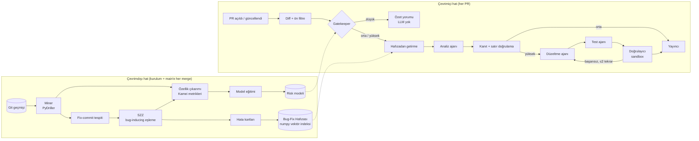

# Aegis — Mimari ve Gereksinimler

## İçindekiler

1. [Kapsam](#1-kapsam)
2. [Genel Akış](#2-genel-akış)
3. [Katman 1 — Gatekeeper](#3-katman-1--gatekeeper)
4. [Katman 2 — Bug-Fix Hafızası](#4-katman-2--bug-fix-hafızası)
5. [Katman 3 — Ajanlar ve Doğrulama](#5-katman-3--ajanlar-ve-doğrulama)
6. [GitHub Çıktısı](#6-github-çıktısı)
7. [Güvenlik](#7-güvenlik)
8. [Fonksiyonel Gereksinimler](#8-fonksiyonel-gereksinimler)
9. [Fonksiyonel Olmayan Gereksinimler](#9-fonksiyonel-olmayan-gereksinimler)
10. [Modüller ve Dizin Yapısı](#10-modüller-ve-dizin-yapısı)
11. [Teknoloji Yığını](#11-teknoloji-yığını)

---

## 1. Kapsam

### Teslim şekli

| Seçenek | Karar | Gerekçe |
| --- | --- | --- |
| **GitHub Action (PR botu)** | ✅ Ana teslim şekli | Suggestion bloğu PR'da var; hafıza CI'da güncellenebilir; patch testleri izole runner'da koşar |
| **CLI** | ✅ Destekleyici | Eğitim, indeksleme, yerel inceleme ve deneyler için. Action da aynı CLI'ı çağırır |
| Pre-push hook | ❌ | Test koşturmak ve hafızayı güncellemek push anında pratik değil |
| GitHub App | ❌ | Sunucu barındırma gerektirir; Action aynı işi altyapısız yapar |

### Kapsam dışı

- Python dışındaki diller için patch üretimi ve test doğrulaması. Gatekeeper metrikleri dilden bağımsızdır, ama yalnızca Python değerlendirilir.
- Pre-push hook, IDE eklentisi, GitHub App, GitLab/Bitbucket
- LLM veya embedding modeli ince ayarı
- Fork PR'larında gizli anahtar gerektiren bulut LLM'leri

Yeni fikirler [ideas.md](ideas.md) dosyasına yazılır.

---

## 2. Genel Akış



**Faz 1 iskeletinde:** Gatekeeper sezgisel bir kuraldır (değişen satır sayısı + riskli yol), hafıza yoktur ve analiz tek bir LLM çağrısıyla yapılır. Sonraki fazlar bu kutuları gerçek bileşenlerle değiştirir. Akışın şekli değişmez.

---

## 3. Katman 1 — Gatekeeper

| Grup | Özellikler | Kaynak |
| --- | --- | --- |
| Yayılım | NS, ND, NF, Entropy | Kamei vd. 2013 |
| Boyut | LA, LD, LT | Kamei vd. 2013 |
| Amaç | FIX | Kamei vd. 2013 |
| Geçmiş | NDEV, AGE, NUC | Kamei vd. 2013 |
| Deneyim | EXP, REXP, SEXP | Kamei vd. 2013 |
| **Aegis'e özgü** | Dokunulan fonksiyonların geçmiş hata kartı sayısı, riskli yol (`auth`, `db`, `payment`…), test değişim oranı | — |

- **SZZ varyantı:** MA-SZZ (meta-change aware), [pyszz](https://github.com/grosa1/pyszz) ile çalıştırılır. Bu varyant boşluk/yorum değişikliklerini, merge'leri ve meta değişiklikleri (dosya taşıma, satır sonu, biçimlendirme) yok sayar. pyszz kurulamazsa PyDriller'ın B-SZZ uygulamasına (`get_commits_last_modified_lines`) geri dönülür. Hangi varyantın kullanıldığı her veri sürümüne yazılır.
- **Geçmiş sınırı:** SZZ varsayılan olarak tüm geçmişe uygulanır; `history_years` ile son N yılla sınırlanabilir. 5 yıllık pencerede 6 hedef repodan yalnızca biri 200 bug-inducing commit'e ulaşıyordu (#13). Tüm geçmişte bile SZZ en büyük hedef repoda 4 dakikadan kısa sürer.
- **Commit etiketi:** SZZ ile bulunan bug-inducing commit'ler pozitif sınıftır.
- **PR etiketi:** Bir PR, içindeki commit'lerden **en az biri** bug-inducing ise hatalıdır. Squash-merge yapan repolarda PR ile commit zaten aynı şeydir.
- **Commit → PR eşlemesi (#73):** GitHub API'si olmadan, `main`'in ilk ebeveyn hattından: "Merge pull request #N" merge commit'leri (PR commit'leri `ebeveyn1..ebeveyn2`) ve başlığı "(#N)" ile biten squash commit'leri. Rebase ile birleştirilen PR'lar ayırt edilemez ve dışarıda kalır. D1'in 6 reposunda 9.117 PR bulundu: black squash; scrapy, tornado, luigi ve sanic ağırlıklı merge stili; tqdm'de yalnızca 61 PR var. `aegis dataset --level pr` → `d1-pr.parquet`, `aegis train --level pr`. PR'ın geçmişe dayalı metrikleri PR'ın **ilk** commit'inin zamanında hesaplanır. Merge zamanı ya da sonraki commit'lerin özellikleri değiştirmediği birim testle doğrulanır.
- **PR modeli ve commit modelinin birleşimi:** Aynı PR test kümesinde, PR satırlarıyla eğitilen model ile commit modelinin `1 − Π(1 − pᵢ)` birleşimi karşılaştırıldı (`eval/compare_pr_level.py`). Merge stili repolarda (scrapy, tornado) LR'de PR modeli ROC-AUC 0,739 / PR-AUC 0,254, birleşim 0,723 / 0,247; Recall@%20 efor ise birleşimde daha yüksek (0,63'e karşı 0,55). Squash repolarda PR zaten tek commit olduğundan iki yol neredeyse aynı (black: 0,779 ve 0,769). Fark tutarlı değil ve RF'de yön değişiyor. Bu yüzden çalışma anında commit modeli → PR birleşimi kalır: her PR'a uygulanabilir (rebase dahil), eşleme gerektirmez ve daha fazla eğitim verisi kullanır. httpie (8) ve tqdm (2) test kümesinde çok az hatalı PR olduğu için bu iki repo yorumlanmamalı.
- **PR özellikleri:** Kamei metrikleri PR'ın birleştirilmiş diff'i üzerinden hesaplanır. Bunlara commit sayısı ve PR'daki farklı yazar sayısı eklenir. **Yalnızca PR açıldığı veya güncellendiği anda bilinen** bilgiler kullanılır. PR süresi, review sayısı ve yorum sayısı gibi sonradan oluşan bilgiler kullanılmaz.
- **Zaman kuralı (`as_of`):** Her özellik, değerlendirilen commit veya PR'ın tarihinde bilinen veriyle hesaplanır. Özellik fonksiyonları zorunlu bir `as_of: datetime` parametresi alır; hafızadan gelen hata yoğunluğu da bu kurala tabidir. Geleceğe tarihli bir kart eklendiğinde özellik değerinin değişmediğini doğrulayan bir birim testi bulunur. Böylece sızıntı kod düzeyinde engellenir.
- **Doğrulama:** Zaman sıralı bölme. Son N günün commit'leri eğitimden çıkarılır, çünkü hataları henüz keşfedilmemiş olabilir (*etiket gecikmesi*).
- **Modeller:** Lojistik regresyon (taban çizgisi), Random Forest, LightGBM.
- **Sınıf dengesizliği (#16):** Sınıf ağırlıkları, alt örnekleme ve SMOTE karşılaştırıldı (6 repo × 3 model, tek tohum). Hiçbiri yöntemsiz eğitimden tutarlı biçimde iyi değil. Repolar üzerinden ortalama test PR-AUC'si LR'de yöntemsiz 0,273, ağırlıklı 0,259, alt örneklemeli 0,266, SMOTE'lu 0,256. MCC'de de en iyisi yöntemsiz. Doğrulamada alt örnekleme önde görünse de bu avantaj test kümesine taşınmıyor. Yeniden örnekleme ayrıca olasılıkları bozar; kalibrasyon (#18) ve bütçe eşiği bu olasılıklara dayandığı için varsayılan **yöntemsiz** eğitimdir. Yöntemler `aegis train --imbalance` ile denenebilir; tablo `eval/compare_imbalance.py` ile üretilir.
- **Kalibrasyon (#18):** Ham skorlar doğrulama kümesinde Platt (sigmoid) yöntemiyle olasılığa çevrilir (`[training].calibration`). 6 repo ortalamasında sigmoid, RF'de test ECE'sini 0,067'den 0,037'ye, LightGBM'de 0,083'ten 0,043'e indiriyor. LR zaten iyi kalibre (0,039 → 0,040). Sıralama korunduğu için ROC-AUC ve PR-AUC değişmiyor. Isotonic doğrulamada kusursuz görünüyor (ECE 0) ama aşırı uyuyor: testte sigmoidden kötü ve PR-AUC'yi düşürüyor. Eğriler `eval/plot_calibration.py` ile SVG olarak çizilir.
- **PR skoru (FR-11):** PR etiketi "en az bir commit hatalı" olduğundan, kalibre commit olasılıkları bağımsız sayılarak `1 − Π(1 − pᵢ)` ile birleştirilir (`TrainedModel.score_pr`). PR düzeyindeki özellikler #73'te gelir.
- **Karar:** Skor üç banda ayrılır: düşük, orta, yüksek. Eşik ya doğrudan verilir ya da "PR'ların en fazla %X'i LLM'e gitsin" bütçesinden hesaplanır (`max_llm_pr_ratio`). Bütçe eşiği, doğrulama skorlarında `skor ≥ eşik` payı X'i aşmayacak en küçük değerdir; yüksek bant bunun en riskli `high_share` kadarıdır. **Bulgu:** Doğrulamada seçilen eşik test döneminde bütçeyi aşıyor. %20 bütçede LLM'e giden pay ortalama %26 (LR) ile %34 (RF) arasında, recall 0,62–0,67. Neden: daha yeni commit'lerin skorları yukarı kayıyor. Bu yüzden çalışma anında eşik, model modunda puanlanmış son `budget_window` (50) PR'ın skorundan yeniden hesaplanır (`runs.jsonl`). Bu skorlar hem zamanla kaymayı izler hem de commit değil PR düzeyindedir. En az `budget_min_runs` (20) kayıt yoksa doğrulama skorları kullanılır (#66).
- **Açıklama (#19):** En etkili 3 özellik çıkarılır ve Türkçe cümle olarak PR yorumunda gösterilir (`aegis.gatekeeper.explain`). `shap` paketi yerine her modelin kesin ya da yerleşik yöntemi kullanılır: LR'de doğrusal SHAP, LightGBM'de yerleşik TreeSHAP, RF'de Saabas katkıları (SHAP'a yakın; tutarlılık garantisi yok). Her yöntemde katkılar ile taban değerin toplamı modelin çıktısına eşittir ve bu birim testle doğrulanır. PR yorumunda en riskli commit'te riski **artıran** ilk 3 özellik gösterilir. Bunun nedeni, ilişkili özelliklerin (NF, ND, LA) doğrusal modelde ters işaretli katkı alıp "5 dosya değişti (riski azaltıyor)" gibi yanıltıcı cümleler üretebilmesi. 6 repo × 3 modelde en önemli özellik LA (ortalama sıra 2,3; 18 durumun 15'inde ilk 3'te), ardından LD, LT, NDEV ve deneyim metrikleri (EXP, SEXP) geliyor. FIX hiçbir durumda ilk 3'e girmiyor. Tablo `eval/explain_importance.py` ile üretilir.
- **Devreye alma (#66):** `[gatekeeper] mode = "model"` ile `aegis review`, GitHub Action ve `aegis score` eğitilmiş modeli `Gatekeeper` protokolü arkasında kullanır (`gatekeeper.factory`). Model, PR'ın `base..head` aralığındaki commit'leri puanlar; gerekçeler (en etkili 3 özellik) PR yorumuna ve analiz prompt'una gider. Model dosyası ya da madencilik geçmişi yoksa, ya da puanlama hata verirse sezgisel kurala dönülür (fail-open). Telemetri her çalıştırmada skoru üreten gatekeeper'ı kaydeder. Action'da model ve geçmiş, durum arşivi (#45) gelene kadar bulunmaz; orada sezgisel kural çalışır.
- **RQ1 ilk sonuçları (#21):** Maliyet–recall eğrisi PR düzeyinde, kayan pencereyle çizildi (`eval/rq1_curve.py` → `eval/reports/rq1/`). Her reponun PR'larının son yarısı 5 pencereye bölündü; her pencerede modeller yalnızca pencereden önceki commit'lerle eğitildi, RF ve LightGBM için 5 tohum kullanıldı. tqdm 61 PR ile dışarıda kaldı. Çalışma anındaki yöntem (commit modeli → PR) sezgisel kural ve rastgele seçimle karşılaştırıldı. #8 sonrası etiketlerle, pencere × repo ortalamasında PR'ların %40'ı LLM'e gittiğinde yakalanan hatalı PR oranı: LR %86 ± 15, LR + yeni özellikler %86, RF + yeni özellikler %85, RF %81, sezgisel kural %78, rastgele %40. Model sezgisel kuraldan anlamlı biçimde iyi (LR + yeni özellikler: +8,2 puan, Wilcoxon p = 0,004). Fix sınıflandırıcısı sıkılaştırılmadan önce bu fark +6,1 puandı; etiket gürültüsü azaldıkça modelin avantajı büyüyor. Riskli yol ve test oranı (FR-12) LR'ye katkı sağlamıyor ama RF'yi anlamlı biçimde iyileştiriyor (+4,1 puan, p = 0,03); bu yüzden varsayılan özellik seti Kamei + bu ikisi (`FULL_FEATURES`). Son 5 yılla eğitim tüm geçmişten iyi değil (−4,4 puan, anlamlı değil); tüm geçmiş korunuyor. Fark mütevazı kalıyor: sezgisel kural yalnızca boyuta ve yola baktığı halde güçlü ve SZZ eşlemelerinin yalnızca ~%31'i doğru (bkz. mining-schema.md, Etiket kalitesi). RQ1 yorumunda bu belirtilmeli.
- **Hafıza sinyali (#29, RQ2'nin LLM'siz ikinci kısmı):** `mem_func_bugs` (değişen fonksiyonlardan birini daha önce düzeltmiş kart sayısı) ve `mem_file_bugs` (aynı dosyalara dokunmuş önceki kart sayısı). Yalnızca `fix_date < as_of` olan kartlar sayılır; geleceğe tarihli bir kartın değeri değiştirmediği birim testle doğrulanır. Fonksiyonlar `(dosya, kısa ad)` çiftiyle eşlenir (madencilikte lizard, çalışma anında ve kartlarda `ast`). D1 için kartların `aegis dataset`'ten önce `aegis index` ile üretilmiş olması gerekir. Sinyal hatalı olmakla ilişkili (repo başına korelasyon 0,12–0,33). RQ1 kayan pencereli karşılaştırmasında (aynı PR test pencereleri) hafıza sinyali **dar bütçelerde** kazanç sağlıyor: PR'ların %10'u LLM'e gittiğinde yakalanan hatalı PR oranı LR'de +4,0, RF'de +6,9 puan; %20'de LR'de +6,8, RF'de +5,5 puan. Aynı dağılımlı ama bilgisiz bir **plasebo** (hafıza değerleri commit'ler arasında karıştırılır) hiç kazanç getirmiyor (LR: −0,2 puan, p = 1,0); hafıza − plasebo farkı %10'da LR +4,2, RF +7,7 puan. Yedi karşılaştırmalık aileye Holm düzeltmesi uygulandığında %10'daki farklar anlamlı (p = 0,043–0,049), %20'dekiler sınırda (p = 0,045–0,076); etki büyüklükleri büyük (rank-biserial r = 0,6–0,9). %40'ta fark yok. Yani kazanç hafızanın içeriğinden geliyor ve LLM'e yalnızca en riskli birkaç PR gidecekken ortaya çıkıyor; hiçbir bütçede zarar vermiyor. Tüm tablolar ve güven aralıkları `docs/results.md`'de. Varsayılan özellik seti bu yüzden Kamei + riskli yol + test oranı + hafıza (`MEMORY_FEATURES`). Tablo `eval/rq1_curve.py` (`lr+m`, `rf+m`) ile üretilir.
- **İşletme noktaları:** Eşik, çalışma anındaki gibi bir önceki pencerenin skorlarından seçilip mevcut pencerede ölçüldü. **Maliyet odaklı** nokta (hedef %60 eleme) LR'de ortalama %58 eleme ve %82 recall veriyor; sezgisel kuralda %60 eleme ve %73 recall. **Güvenlik odaklı** hedef (recall ≥ %90) önceki pencereden taşınan eşikle tutturulamıyor: LR'de %54 eleme ve %76 ± 26 recall. Pencereler arasında hatalı PR sayısı çok değiştiği için (ör. scrapy'de 15 ile 78 arası) recall'a dayalı eşik kararsız. Eğriye göre %90 recall için PR'ların yaklaşık %55–60'ının LLM'e gitmesi gerekiyor (≈ %40–45 eleme). Bu yüzden güvenlik odaklı kullanımda eşik recall hedefiyle değil bütçeyle (`max_llm_pr_ratio` ≈ 0,6) verilmeli.
- **Soğuk başlangıç (#17):** Geçmişi az olan repolarda diğer repolarda eğitilmiş genel model kullanılır (`aegis train --repo all`, `.aegis/models/all/`). Leave-one-project-out değerlendirmede hedef reponun test kümesi repo içi senaryodakiyle aynıdır. Genel model, diğer 5 reponun yalnızca o test döneminden önceki commit'leriyle eğitilir. LR'de repolar üzerinden ortalama test PR-AUC'si repo içinde 0,273, repolar arasında 0,247; ROC-AUC 0,785 ve 0,766. Yani genel model yaklaşık %10 kayıpla çalışıyor. Geçmişi kısa repolarda (tqdm, black, httpie) genel model repo içi modele denk ya da ondan iyi. Tablo `eval/compare_scenarios.py` ile üretilir.

---

## 4. Katman 2 — Bug-Fix Hafızası

**Hata kartı:**

```json
{
  "id": "BC-0142",
  "fix_sha": "a1b2c3d",
  "fix_date": "2026-03-14T10:22:00Z",
  "inducing_shas": ["9f8e7d6"],
  "issue": { "number": 89, "title": "Memory leak in connection pool" },
  "files": ["app/db/pool.py"],
  "functions": ["app.db.pool.ConnectionPool.release"],
  "message": "fix: release connections on timeout (#89)",
  "before": "def release(self, conn): ...",
  "after": "def release(self, conn): ...",
  "fix_diff": "@@ -40,6 +40,9 @@ ...",
  "summary": "Zaman aşımında bağlantı havuza iade edilmiyordu; finally bloğu eklendi."
}
```

- **Sorgu:** PR'da değişen fonksiyonların kodu, nitelikli adı ve diff'i.
- **Getirme (#25):** (1) Aynı dosya/fonksiyon için yapısal eşleşme, (2) BM25, (3) vektör benzerliği. Sonuçlar RRF ile birleştirilir (puan = Σ 1/(60 + sıra), her yöntemin ilk 50 kartı); en iyi *k* kart (`[memory].top_k`, varsayılan 3) seçilir. `[memory].retrieval` = `hybrid`, `structural`, `bm25` ya da `vector` (ablasyon için). Yapısal puan: aynı fonksiyon 2, aynı dosya 1; her eşleşme kartın fonksiyon ve dosya sayısına bölünür. Böylece çok dosyaya dokunan toplu commit'ler ("fix linkcheck", "docstring fixes") yalnızca aynı dosyayı da değiştirdikleri için üste çıkmaz. BM25 (k1 = 1,2, b = 0,75) kart metni üzerinde, embedding ile aynı kod duyarlı belirteçlerle çalışır. Sorgu, incelenen aralığın kaynak dosyaları, değiştirdiği fonksiyonların nitelikli adları ve kodu ile diff'inden kurulur (`query_from_range`). Her sonuç, hangi yöntemde kaçıncı sırada olduğunu da taşır.
- **Getirme değerlendirmesi (#27, RQ2'nin LLM'siz kısmı):** Sorgular, SZZ'ye göre hata getiren commit'lerdir (X); sorgu yalnızca X'ten kurulur ve yalnızca X'ten önce düzeltilmiş kartlar aranır. X'in hatasını sonradan düzelten fix'in (F) değiştirdiği fonksiyonlardan birini daha önce düzeltmiş kartlar ilgili sayılır: "hafıza, bu PR'ın hatasının gerçekte düzeltileceği koddaki geçmiş fix'leri getiriyor mu?". F yalnızca puanlamada kullanılır. 6 repoda 906 sorgu (`eval/retrieval_eval.py` → `eval/reports/retrieval.md`):

  | Mod | Recall@1 | Recall@3 | Recall@5 | MRR |
  | --- | --- | --- | --- | --- |
  | yapısal | 0,435 | 0,571 | 0,621 | 0,514 |
  | BM25 | 0,447 | 0,587 | 0,662 | 0,535 |
  | vektör (LSA) | 0,449 | 0,584 | 0,671 | 0,540 |
  | **hibrit (RRF)** | **0,504** | **0,631** | **0,690** | **0,582** |
  | rastgele | 0,045 | 0,110 | 0,146 | 0,093 |

  Hibrit, her tek yöntemden anlamlı biçimde iyi (MRR farkı yapısala +0,068, BM25'e +0,047, vektöre +0,042; eşleştirilmiş Wilcoxon, hepsinde p < 10⁻⁷). Altı reponun beşinde en iyi mod hibrit; httpie'de (40 sorgu) modlar eşit. İlgi tanımı fonksiyon adına dayandığı halde yapısal arama tek başına en zayıf mod: sorgu PR'ın değiştirdiği fonksiyonlardan kurulur, hata ise çoğu zaman başka bir fonksiyonda düzeltilir. Sınırlamalar: ilgi tanımı SZZ'ye dayanır (eşlemelerin ~%31'i doğru) ve vektör kolu nöral değil LSA'dır; nöral embedding (`ollama:<model>`) bir Ollama sunucusu bulunursa aynı betikle karşılaştırılabilir.
- **Analiz prompt'una ekleme (#33):** Risk düşük değilse ve LLM çalışacaksa, PR'ın değiştirdiği koddan sorgu kurulur ve hibrit getirmenin ilk `top_k` kartı analiz ajanına verilir (`gatekeeper.factory.make_memory`). Yalnızca head commit'inin tarihinden önce düzeltilmiş kartlar döner. Kartlar prompt sürümü **v2**'de `<bug_memory>` bloğundadır: kimlik, tarih, özet, fonksiyonlar, fix öncesi ve sonrası kod. Blok `[memory].max_prompt_chars` (12.000 karakter, ~3k token) bütçesiyle sınırlıdır; sığmayan ilk kart kırpılır, sonrakiler çıkar. Kart içeriği güvenilmeyen veri sayılır: `<bug_memory>` ayracı da injection korumasına eklendi. Model, bulguya benzeyen kartın kimliğini `memory_refs` alanına yazar; prompt'ta gösterilmemiş kimlikler düşürülür ve sayılır. Kart ya da indeks yoksa veya getirme hata verirse inceleme kartsız sürer (fail-open, `memory_error`). Telemetri her çalıştırmada kart ve referans sayısını kaydeder. Gerçek LLM ile denenmedi (yerel LLM kurulmuyor); sahte sağlayıcıyla test edildi.
- **Zamansal filtre (#26):** Yalnızca `fix_date < PR tarihi` olan kartlar getirilir; kural arama fonksiyonunun içindedir, değerlendirmede de aynı şekilde uygulanır.
- **Embedding (#24):** `[memory].embedding_model` ile seçilir. Varsayılan `lsa`: TF-IDF + kesik SVD (scikit-learn), kod duyarlı belirteçleme (`snake_case`/`camelCase` parçalanır). Kartlar üzerinde eğitilir; model indirmesi ve internet gerektirmez. `ollama:<model>` (ör. `nomic-embed-text`) yerel Ollama embedding modelini kullanır; gerçek model koşuları proje sonunda yapılacağı için yalnızca sahte istemciyle test edildi. Planlanan sentence-transformers, bu ortamda torch kurulamadığı için kullanılmadı.
- **Saklama (#24):** Repo başına `<index_path>/<repo>/`: `vectors.npy` (L2 normalize), `embedder.pkl`, `index.json` (şema ve Aegis sürümü, embedding modeli, kart sayısı, kartların SHA-256 özeti, kimlikler ve fix tarihleri). Arama tam taramadır (kosinüs). 6 hedef repoda 120–832 kart var; indeks kurulumu repo başına 3–4 saniye, arama milisaniyeler sürüyor. Planlanan LanceDB pyarrow gerektiriyor (bu makinede Smart App Control engelliyor) ve bu ölçekte gereksiz.
- **Kart üretimi (#22, #23):** `aegis index <repo>` madencilik çıktısındaki her fix commit'inden (merge değil, en az bir kaynak dosyaya dokunan) bir kart üretir ve `<data>/<repo>/cards.jsonl` dosyasına yazar. Varsayılan olarak artımlıdır: yalnızca kartı olmayan fix'ler eklenir (`--rebuild` sıfırdan kurar). Fonksiyonlar `ast` ile bulunur; nitelikli ad modül yolunu, iç içe sınıfları ve iç fonksiyonları içerir (`tqdm._tqdm.tqdm`, `app.db.pool.ConnectionPool.release`). Diff'te değişen satırlar en içteki fonksiyona eşlenir; sözdizimi hatalı dosyalar atlanır. `before`/`after` alanları fonksiyonun tamamını taşır; uzun fonksiyonlarda imza satırı ve değişen satırların çevresi tutulur (`[memory].max_code_lines`, `max_functions_per_card`, `max_diff_lines`). Issue başlığı yalnızca `--issue-titles` ile GitHub'dan okunur (GITHUB_TOKEN; diskte cache'lenir). `summary` şimdilik commit başlığıdır; LLM özeti gerçek model koşularıyla gelecek.

### Dağıtım ve kalıcılık

Tüm geçmişi CI'da taramak büyük repolarda çok uzun sürer. Bu yüzden:

1. **İlk kurulum yerelde yapılır:** `aegis mine` + `aegis index` + `aegis dataset` + `aegis train`. Madencilik verisi (kartlar dahil), çalışma anı modeli (repo modeli ve genel model) ve son işlenen SHA tek bir `tar.gz` arşivinde toplanır ve repo'nun `[state].release_tag` etiketli **GitHub Release**'ine `aegis-state-<repo>.tar.gz` asset'i olarak yüklenir (`aegis publish-state`; `--out` ile yalnızca yerel dosya). Deney model varyantları arşive girmez; LSA indeksi de girmez, çünkü kartlardan birkaç saniyede yeniden kurulur. scrapy için arşiv 3,7 MB (11 dosya). Açma anında, indeksin yeniden kurulması 4,4 saniye sürüyor. Arşiv yalnızca bilinen bölümlere düz dosya yazar; `..`, mutlak yol ve bağlantı içeren girdiler reddedilir (#45).
2. **Her PR'da** Action, `actions/cache`'te durum varsa onu kullanır; yoksa Release asset'ini indirir (`aegis fetch-state`) ve cache'e kaydeder. Hiçbir durumda tüm geçmişi yeniden taramaz.
3. **`main`'e her merge'de** yalnızca son SHA'dan sonraki commit'ler işlenir. Güncellenen durum cache'e yazılır.
4. **Modelin yeniden eğitimi** haftalık zamanlanmış bir workflow'da yapılır ve Release asset'i güncellenir.
5. Asset de cache de yoksa Action sezgisel gatekeeper ile, hafızasız çalışır (fail-open).

---

## 5. Katman 3 — Ajanlar ve Doğrulama

| Bileşen | Tür | Girdi | Çıktı |
| --- | --- | --- | --- |
| Analiz ajanı | LLM | Diff + bağlam + gatekeeper açıklaması + hata kartları | `findings[]` |
| Düzeltme ajanı | LLM | Bulgu + fonksiyon + (varsa) önceki doğrulama hatası | Unified diff |
| Test ajanı | LLM | Bulgu + fonksiyon + mevcut test örnekleri | pytest dosyası |
| Doğrulayıcı | Deterministik | Patch + test | Statü + log |
| Yayıncı | Deterministik | Bulgular + statüler | Özet yorumu, satır yorumları, suggestion'lar |

| Statü | Koşul | Yayın biçimi |
| --- | --- | --- |
| `verified` | Patch uygulanıyor, mevcut testler geçiyor, üretilen test patch öncesi başarısız ve sonrası başarılı | ` ```suggestion ` bloğu |
| `plausible` | Patch uygulanıyor ve mevcut testler geçiyor, ancak hatayı yeniden üreten test yazılamadı | Uyarı etiketli öneri |
| `unverified` | Patch uygulanamadı, testler kırıldı veya doğrulama süre sınırını aştı | Yalnızca bulgu açıklaması (kodsuz) |

**Süre bütçesi:** Tüm test takımını her bulgu için koşturmak büyük repolarda dakikalar sürer. Bu yüzden:

- **Test seçimi:** Yalnızca değişen kodu etkileyen testler koşturulur. Birincil yöntem [pytest-testmon](https://github.com/tarpas/pytest-testmon)'dur: kapsama (coverage) verisine dayanır ve testmon veritabanı da durum arşivinde taşınır. Testmon verisi yoksa değişen modülü import eden test dosyaları seçilir.
- **Paralellik:** `pytest-xdist` kullanılır.
- **Sınırlar:** PR başına en fazla 2 patch denenir (en yüksek severity × confidence). Diğer bulgular kodsuz yayınlanır. Doğrulama başına süre sınırı vardır; aşılırsa statü `unverified` olur.

**Üretilen testin teslimi:** GitHub suggestion bloğu yeni dosya oluşturamaz. Bu yüzden üretilen test, satır yorumunun altında açılır-kapanır bir bölümde, önerilen dosya yoluyla birlikte verilir. Testi otomatik commit eden bir komut v1 kapsamı dışındadır (bkz. [ideas.md](ideas.md)).

**Orkestrasyon:** Zincir, Pydantic modelleri üzerinde çalışan küçük bir durum makinesiyle yönetilir. Hazır bir ajan çerçevesi kullanılmaz; bu sayede bağımlılık az kalır ve her adım birim testle doğrulanabilir.

**Analiz ajanı çıktı şeması:**

```json
{
  "type": "object",
  "required": ["findings", "summary"],
  "properties": {
    "summary": { "type": "string", "maxLength": 400 },
    "findings": {
      "type": "array",
      "items": {
        "type": "object",
        "required": ["file", "line", "category", "severity", "confidence", "title", "explanation", "evidence"],
        "properties": {
          "file":        { "type": "string" },
          "line":        { "type": "integer", "minimum": 1 },
          "end_line":    { "type": "integer", "minimum": 1 },
          "category":    { "enum": ["bug", "security", "concurrency", "resource-leak", "error-handling", "api-misuse", "regression", "performance"] },
          "severity":    { "enum": ["critical", "high", "medium", "low"] },
          "confidence":  { "type": "number", "minimum": 0, "maximum": 1 },
          "title":       { "type": "string", "maxLength": 120 },
          "explanation": { "type": "string" },
          "evidence":    { "type": "string", "description": "Bulgunun dayandığı diff satırının birebir alıntısı" },
          "memory_refs": { "type": "array", "items": { "type": "string" } }
        }
      }
    }
  }
}
```

---

## 6. GitHub Çıktısı

Özet yorumu her PR'da tektir ve yeni push'larda güncellenir:

> **🛡️ Aegis — Risk: 0.82 (yüksek)**
> Neden: bu fonksiyonda geçmişte 2 hata düzeltilmiş · 3 alt sisteme yayılan değişiklik · yazar bu modülde yeni
> Hafıza: `BC-0142` (#89, bağlantı havuzu sızıntısı)
> Sonuç: 1 bulgu · 1 doğrulanmış öneri · 4.120 token · 0,006 $

Satır yorumu:

````markdown
**[resource-leak · critical · 0.86]** Zaman aşımı yolunda bağlantı havuza iade edilmiyor.
Bu fonksiyonda #89'da aynı sorun yaşanmış ve `finally` ile çözülmüştü (BC-0142).

```suggestion
        try:
            return await conn.execute(query, timeout=timeout)
        finally:
            await self.release(conn)
```

✅ Doğrulandı: üretilen test patch öncesi başarısız, sonrası başarılı · seçilen 38 test geçti.

<details><summary>Üretilen test — önerilen yol: tests/test_pool_timeout.py</summary>

```python
async def test_release_on_timeout(pool):
    ...
```
</details>
````

---

## 7. Güvenlik

| Tehdit | Önlem |
| --- | --- |
| **Prompt injection:** PR'daki kod, yorum veya string LLM'i yönlendirmeye çalışır (ör. "bu kodu güvenli say", "şu patch'i öner") | PR içeriği prompt'ta ayraçlarla veri olarak işaretlenir. Sistem prompt'u bu içerikteki talimatları yok saymasını söyler. Ajanların araç yetkisi yoktur, yalnızca JSON üretirler. Her çıktı deterministik filtrelerden geçer: kanıt kontrolü, hunk sınırı, doğrulayıcı. Bilinen saldırı örnekleriyle regresyon testleri yazılır. |
| **Güvenilmeyen kodun çalıştırılması** | Testler ağsız (`--network none`), CPU/bellek/süre sınırlı, gizli anahtarsız bir Docker sandbox'ında koşar |
| **Fork PR'larında gizli anahtar sızması** | `pull_request_target` kullanılmaz. Fork PR'larında yalnızca gatekeeper ve yerel model çalışır |
| **Kod gizliliği** | Kod yalnızca seçilen sağlayıcıya ve yalnızca gatekeeper'ı geçen PR'larda gider. Ollama ve yerel embedding modeliyle tamamen çevrimdışı çalışabilir |
| **Zararlı veya yanlış patch** | Doğrulanmayan patch suggestion olarak yayınlanmaz. Hiçbir şey otomatik merge edilmez |

---

## 8. Fonksiyonel Gereksinimler

**Diff ve iskelet**

| ID | Gereksinim | Öncelik |
| --- | --- | --- |
| FR-06 | PR veya commit aralığının diff'i dosya/hunk/satır modeline çevrilir. Binary, lock, minified ve üretilmiş dosyalar elenir. | Must |
| FR-17 | Eğitilmiş model yokken **sezgisel gatekeeper** kullanılır: değişen satır sayısı ve riskli yol. Bu kural deneylerde taban çizgisi olarak da kullanılır. | Must |

**Repo madenciliği**

| ID | Gereksinim | Öncelik |
| --- | --- | --- |
| FR-01 | `aegis mine <repo>` commit geçmişini PyDriller ile tarar; commit, dosya ve fonksiyon düzeyindeki değişiklikleri Parquet'e yazar. | Must |
| FR-02 | Fix commit'leri mesaj kalıpları (`fix`, `bug`, `regression`, `leak`, `crash`, `closes #N`) ve GitHub issue etiketleriyle tespit edilir. | Must |
| FR-03 | SZZ (MA-SZZ, pyszz; yedek: PyDriller B-SZZ) ile bug-inducing commit'ler bulunur. Meta değişiklikler yok sayılır; merge commit'leri ve çok büyük commit'ler elenir; yalnızca son N yıl işlenir. | Must |
| FR-04 | 14 Kamei JIT metriği hesaplanır. | Must |
| FR-05 | Madencilik artımlıdır: yalnızca son işlenen SHA'dan sonraki commit'ler işlenir. | Must |
| FR-07 | `aegis publish-state` model, indeks, testmon verisi ve son SHA'yı tek arşivde toplayıp GitHub Release asset'i olarak yükler. Action bu arşivi kullanır. | Must |

**Gatekeeper**

| ID | Gereksinim | Öncelik |
| --- | --- | --- |
| FR-10 | `aegis train` zaman sıralı doğrulamayla model eğitir; `aegis score BASE..HEAD` aralığı skor, bant ve açıklamayla puanlar (#20). | Must |
| FR-11 | PR düzeyinde 0–1 arası risk skoru üretilir. PR etiketi: içindeki commit'lerden en az biri bug-inducing ise hatalı. Yalnızca PR açılış/güncelleme anında bilinen bilgiler kullanılır. | Must |
| FR-12 | Ek özellikler: hafızadan gelen hata yoğunluğu, riskli yol, test değişim oranı, commit ve yazar sayısı. | Should |
| FR-18 | Tüm özellikler zorunlu `as_of` parametresiyle, yalnızca o tarihte bilinen veriyle hesaplanır. | Must |
| FR-13 | Üç risk bandı vardır. Eşikler config'den veya bütçeden belirlenir. | Must |
| FR-14 | SHAP ile en etkili 3 özellik açıklanır. | Should |
| FR-15 | Soğuk başlangıçta repolar arası genel model kullanılır. | Should |
| FR-16 | `aegis:force` etiketi gatekeeper'ı atlar. | Could |

**Bug-fix hafızası**

| ID | Gereksinim | Öncelik |
| --- | --- | --- |
| FR-20 | Her fix commit'inden bir hata kartı üretilir. | Must |
| FR-21 | Kod fonksiyon düzeyinde parçalanır (`ast`). | Must |
| FR-22 | Hibrit arama: yapısal + BM25 + vektör, RRF ile birleştirme. | Must |
| FR-23 | Zamansal filtre: yalnızca PR tarihinden önceki kartlar. | Must |
| FR-24 | `main`'e merge'de artımlı güncelleme. | Should |
| FR-25 | Karta ucuz bir modelle "kök neden / düzeltme kalıbı" özeti eklenir. | Could |

**Ajanlar ve doğrulama**

| ID | Gereksinim | Öncelik |
| --- | --- | --- |
| FR-30 | Analiz ajanı şemaya uygun bulgular üretir ve kullandığı kartları `memory_refs` alanında belirtir. | Must |
| FR-31 | `evidence` diff'te birebir yoksa veya bulgu satırı değişen satırlara denk gelmiyorsa bulgu düşürülür. | Must |
| FR-32 | Düzeltme ajanı yalnızca ilgili hunk bölgesini değiştiren minimal bir diff üretir. | Must |
| FR-33 | Test ajanı hatayı yeniden üreten bir pytest testi yazar. | Must |
| FR-34 | Doğrulayıcı sırasıyla apply → lint → mevcut testler → üretilen test (önce/sonra) adımlarını çalıştırır ve statü belirler. | Must |
| FR-35 | Doğrulama başarısızsa en fazla 2 tekrar yapılır. | Must |
| FR-36 | Testler ağsız, kaynak sınırlı bir Docker sandbox'ında koşar. | Must |
| FR-37 | Her ajan için model ayrı seçilebilir. | Should |
| FR-38 | Doğrulamada yalnızca etkilenen testler koşar (pytest-testmon; yedek: import tabanlı seçim) ve testler paralel çalışır (pytest-xdist). | Must |
| FR-39 | PR başına en fazla 2 patch denenir; doğrulama süre sınırını aşarsa statü `unverified` olur. | Must |

**GitHub ve CLI**

| ID | Gereksinim | Öncelik |
| --- | --- | --- |
| FR-40 | Aegis, `pull_request` olayında çalışan bir GitHub Action'dır. | Must |
| FR-41 | Tek bir özet yorumu yazılır ve yeni push'larda güncellenir. | Must |
| FR-42 | `verified` patch'ler suggestion bloğu olarak yayınlanır; hunk'a sığmayanlar açılır-kapanır diff olarak verilir. | Must |
| FR-43 | `plausible` patch'ler uyarı etiketiyle, `unverified` olanlar kodsuz olarak yayınlanır. | Must |
| FR-47 | Üretilen test, satır yorumunun altında açılır-kapanır bölümde önerilen dosya yoluyla verilir. | Must |
| FR-44 | `aegis review --base main` aynı hattı yerelde çalıştırır. | Must |
| FR-45 | Çalıştırma metrikleri JSONL olarak kaydedilir. | Should |
| FR-46 | Öneriler 👍/👎 tepkisiyle değerlendirilebilir. | Could |

---

## 9. Fonksiyonel Olmayan Gereksinimler

| ID | Gereksinim |
| --- | --- |
| NFR-01 | **Fail-open:** Aracın kendi hatası PR'ı bloklamaz; check `neutral` sonuçlanır ve bir uyarı yorumu bırakılır. |
| NFR-02 | **Sandbox:** `pull_request_target` kullanılmaz. Testler ağsız ve gizli anahtarsız çalışır. |
| NFR-03 | **Gizlilik:** Ollama ve yerel embedding modeliyle tam çevrimdışı mod desteklenir. |
| NFR-04 | **Tekrarlanabilirlik:** Veri, model ve indeks sürümlenir; her deney yeniden koşturulabilir. |
| NFR-05 | **Açıklanabilirlik:** Her karar PR yorumunda gerekçesiyle gösterilir. |
| NFR-06 | **Test edilebilirlik:** Çekirdekte ≥ %80 test kapsamı vardır; LLM ve GitHub çağrıları mock'lanabilir. |
| NFR-07 | **Genişletilebilirlik:** Yeni dil, sağlayıcı veya ajan eklemek tek bir protokolü uygulamakla mümkündür. |
| NFR-08 | **Prompt injection direnci:** PR içeriği veri olarak işaretlenir; ajanların araç yetkisi yoktur; saldırı örnekleriyle regresyon testleri yazılır. |

---

## 10. Modüller ve Dizin Yapısı

| Modül | Sorumluluk |
| --- | --- |
| `cli` | `mine`, `train`, `score`, `index`, `publish-state`, `review`, `eval` |
| `diff` | Unified diff modeli, ön filtre, hunk → fonksiyon eşleme |
| `mining` | PyDriller tarayıcı, fix-commit sınıflandırıcı, SZZ |
| `features` | Kamei metrikleri ve ek özellikler |
| `gatekeeper` | Sezgisel kural, eğitim, eşik/bant, SHAP |
| `memory` | Hata kartları, parçalama, embedding, hibrit arama |
| `llm` | Sağlayıcı adaptörleri, structured output, retry, cache |
| `agents` | Analiz/düzeltme/test ajanları, prompt'lar, orkestratör |
| `verify` | Docker sandbox, doğrulayıcı |
| `github` | Olay okuma, yorum ve suggestion yayını |
| `telemetry` | Çalıştırma kayıtları, maliyet |

```
src/aegis/
├── cli.py  config.py  models.py
├── diff/        parse.py  filters.py
├── mining/      miner.py  fixes.py  szz.py
├── features/    kamei.py  extra.py
├── gatekeeper/  heuristic.py  model.py  split.py  calibration.py  explain.py
├── memory/      cards.py  chunker.py  embed.py  retrieve.py
├── llm/         base.py  providers.py  structured.py  cache.py
├── agents/      analyst.py  fixer.py  tester.py  orchestrator.py  prompts/v1/
├── verify/      sandbox.py  verifier.py
├── github/      event.py  publisher.py
└── telemetry/   runs.py
```

---

## 11. Teknoloji Yığını

| Alan | Teknoloji |
| --- | --- |
| Dil ve paketleme | Python 3.12+, uv |
| CLI ve UI | Typer, Rich |
| Modeller ve config | Pydantic v2, tomllib |
| Repo madenciliği | PyDriller, pyszz (MA-SZZ) |
| Veri | pandas / polars, pyarrow (Parquet) |
| ML | scikit-learn, LightGBM (SMOTE ve açıklamalar ek bağımlılık olmadan yerel olarak uygulanır) |
| Kod ayrıştırma | `ast` (ileride tree-sitter), unidiff |
| Embedding ve vektör indeksi | scikit-learn (TF-IDF + SVD), numpy; isteğe bağlı Ollama embedding |
| LLM | `ollama` (yalnızca yerel model); httpx, tenacity |
| GitHub | PyGithub veya httpx ile REST |
| Doğrulama | pytest-testmon (test seçimi), pytest-xdist (paralellik), Docker |
| Test ve kalite | pytest, pytest-cov, pytest-mock, syrupy, ruff, mypy (strict), pre-commit |
| Deneyler | matplotlib, scipy |

LLM modelleri `.aegis.toml` içinde parametredir. Yalnızca Ollama ile çalışan yerel açık kod modelleri kullanılır (ör. `qwen2.5-coder:7b` veya daha yeni bir Qwen Coder sürümü); bulut sağlayıcısı yoktur. Yapılandırılmış çıktı Ollama'nın `format` parametresiyle JSON Schema olarak alınır.
