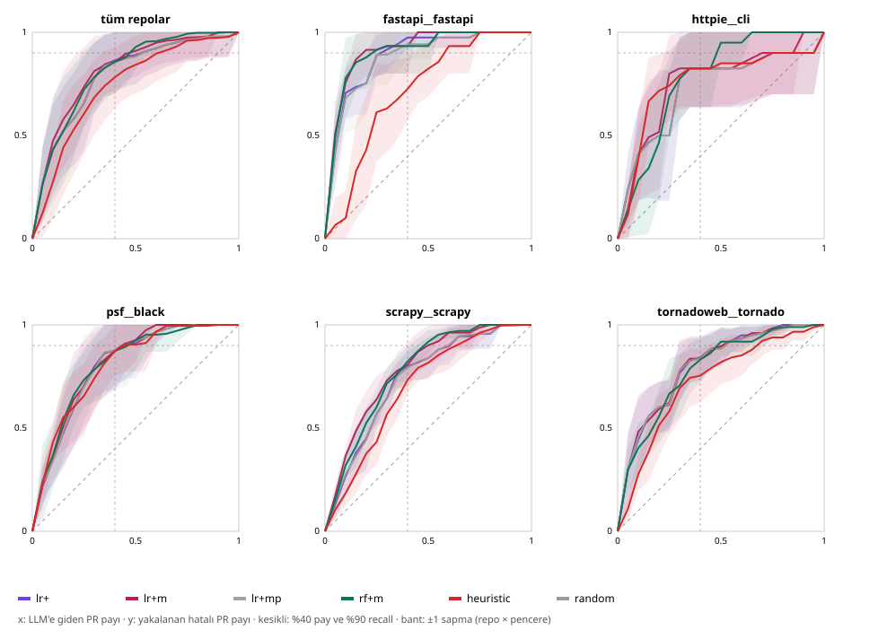

# Sonuçlar (LLM'siz)

> Bu belge `eval/results.py` ile üretilir; elle düzenlemeyin. LLM gerektiren deneyler (ucuz LLM triage #67, LLM'li RQ2, RQ4) burada yok. Yöntem ayrıntıları ve sınırlamalar `docs/architecture.md` ve `docs/mining-schema.md` içinde.

## 1. Veri

| Repo | Commit | Fix | Hatalı commit | Oran | PR | Hatalı PR | PR stili |
| --- | --- | --- | --- | --- | --- | --- | --- |
| scrapy | 9.625 | 1.140 | 1.139 | %11,8 | 2.961 | 450 | merge |
| luigi | 3.047 | 543 | 595 | %19,5 | 1.824 | 407 | merge |
| tornado | 4.138 | 658 | 578 | %14,0 | 1.041 | 161 | merge |
| sanic | 2.112 | 390 | 505 | %23,9 | 1.218 | 366 | merge |
| tqdm | 1.821 | 400 | 396 | %21,8 | 61 | 21 | merge |
| black | 2.502 | 541 | 386 | %15,4 | 2.012 | 273 | squash |

Toplam 23.245 commit. 9.117 PR. Pencere: tüm geçmiş (#13).

200 hatalı commit eşiğinin altında kaldığı için D1'e alınmayan repolar: fastapi (138), httpie (168). Seçim ve gerekçe: `docs/target-repos.md`.

## 2. Etiket kalitesi (#8, #9)

Son etiketler iki bağımsız öneri seti görülerek bir ekip üyesince verildi (yöntem ve sınırlamalar: `docs/mining-schema.md`, Etiket kalitesi).

| Set | Karar – öneri 1 κ | Karar – öneri 2 κ | Öneri 1 – öneri 2 κ |
| --- | --- | --- | --- |
| SZZ eşlemeleri (50) | 0,87 | 0,76 | 0,67 |
| Fix commit'leri (200) | 0,89 | 0,96 | 0,90 |

- **SZZ eşleme doğruluğu:** 15/48 = %31,2 [18,8; 43,8] (%95 GA).
- **Fix sınıflandırıcısı** (`eval/tune_fix.py`; aynı 200 commit'te ayarlandı, iyimser):

| Varyant | Precision | Recall (ağırlıklı) | Popülasyonda fix |
| --- | --- | --- | --- |
| mevcut | 67/95 = %71 | %79 | 3738 |
| +dışlama | 66/77 = %86 | %78 | 3126 |
| +dışlama +başlık | 52/54 = %96 | %63 | 2317 |

## 3. RQ1 — Risk modeli (commit düzeyi, tek zaman bölmesi)

Varsayılan özellik seti (Kamei + riskli yol + test oranı + hafıza), sigmoid kalibrasyon, zaman sıralı bölme. Repolar arası: model yalnızca diğer 5 repoyla eğitilir, aynı test kümesi.

| Model | Senaryo | ROC-AUC | PR-AUC | Recall@%20 efor | Brier | ECE |
| --- | --- | --- | --- | --- | --- | --- |
| lr | repo içi | 0,797 | 0,288 | 0,636 | 0,086 | 0,044 |
| rf | repo içi | 0,770 | 0,253 | 0,626 | 0,089 | 0,048 |
| lightgbm | repo içi | 0,761 | 0,255 | 0,642 | 0,089 | 0,052 |
| lr | repolar arası | 0,805 | 0,300 | 0,657 | 0,084 | 0,042 |
| rf | repolar arası | 0,802 | 0,289 | 0,680 | 0,083 | 0,038 |
| lightgbm | repolar arası | 0,793 | 0,310 | 0,656 | 0,083 | 0,033 |

Ortalama 6 repo üzerinden. Repolar arası genel model repo içi modelden geri kalmıyor; hafıza sayımları (geçmiş hata kartı) repolar arasında iyi genelleşiyor.

## 4. RQ1 — Maliyet–recall eğrisi (PR düzeyi, kayan pencere)

25 birim (5 repo × 5 zaman penceresi; tqdm 61 PR ile dışarıda). Her pencerede modeller yalnızca pencereden önceki commit'lerle eğitildi; RF 5 tohum ortalaması. Hücre: yakalanan hatalı PR oranı, ortalama [%95 bootstrap GA].

| Yöntem | %10 LLM | %20 LLM | %40 LLM | %60 LLM |
| --- | --- | --- | --- | --- |
| LR (tam + hafıza) | %37,6 [32,6; 43,1] | %59,1 [53,4; 64,6] | %82,0 [77,0; 86,8] | %94,1 [91,3; 96,7] |
| RF (tam + hafıza) | %35,2 [30,6; 39,8] | %54,6 [49,3; 60,2] | %80,2 [75,3; 84,8] | %92,6 [89,3; 95,6] |
| LR (tam) | %33,2 [27,6; 39,2] | %54,4 [47,7; 60,7] | %79,5 [74,3; 84,7] | %91,5 [87,6; 94,9] |
| RF (tam) | %30,2 [26,2; 34,2] | %49,9 [45,2; 54,4] | %77,7 [72,5; 82,8] | %91,3 [88,3; 94,1] |
| LR (Kamei) | %33,1 [28,3; 37,9] | %52,1 [46,4; 57,5] | %78,0 [72,9; 83,1] | %90,0 [86,2; 93,4] |
| LR (hafıza plasebosu) | %33,5 [27,6; 39,6] | %54,7 [48,1; 60,8] | %79,6 [74,2; 84,8] | %91,3 [87,6; 94,4] |
| RF (hafıza plasebosu) | %33,5 [28,7; 38,7] | %49,9 [43,5; 56,6] | %76,2 [71,1; 81,4] | %92,1 [89,1; 94,8] |
| Sezgisel kural | %29,3 [24,9; 34,1] | %49,3 [43,6; 55,2] | %74,7 [70,2; 79,6] | %89,1 [85,3; 92,7] |
| Rastgele | %10 | %20 | %40 | %60 |

**İşletme noktaları** (eşik önceki pencereden, ölçüm mevcut pencerede):

| Nokta | Yöntem | Eleme (LLM'e gitmeyen) | Recall |
| --- | --- | --- | --- |
| maliyet odaklı (hedef %60 eleme) | LR (tam + hafıza) | %58,3 [53,1; 63,1] | %82,2 [75,8; 88,0] |
| maliyet odaklı (hedef %60 eleme) | Sezgisel kural | %57,7 [53,7; 61,6] | %75,0 [69,3; 80,7] |
| güvenlik odaklı (hedef ≥ %90 recall) | LR (tam + hafıza) | %53,9 [46,0; 61,6] | %82,7 [74,8; 89,7] |
| güvenlik odaklı (hedef ≥ %90 recall) | Sezgisel kural | %41,1 [33,1; 49,1] | %86,0 [79,4; 91,6] |

**Güvenlik eşiği alternatifleri** (aynı 25 pencere; ortalama [%95 bootstrap GA]):

Eşikler yalnızca geçmiş pencerelerden seçilir. 90 günlük seçenek, PR tarihinden en az 90 gün önceki PR'ları kullanır ve etiketleri bu kesim tarihindeki bilgiyle belirler.

| Kural | Yöntem | Eleme (LLM'e gitmeyen) | Gerçekleşen recall |
| --- | --- | --- | --- |
| Son 2 pencere, hedef recall %90 | LR (tam + hafıza) | %50,2 [44,2; 55,9] | %88,8 [84,7; 92,5] |
| Son 2 pencere, hedef recall %90 | Sezgisel kural | %38,9 [33,1; 44,6] | %89,5 [85,4; 93,3] |
| Son 3 pencere, hedef recall %90 | LR (tam + hafıza) | %49,5 [44,2; 54,8] | %89,5 [85,5; 93,3] |
| Son 3 pencere, hedef recall %90 | Sezgisel kural | %37,6 [32,8; 42,4] | %91,2 [87,7; 94,4] |
| Son pencere, hedef recall %95 | LR (tam + hafıza) | %48,2 [40,6; 56,3] | %86,6 [79,3; 92,6] |
| Son pencere, hedef recall %95 | Sezgisel kural | %31,7 [23,6; 39,9] | %89,9 [83,1; 95,5] |
| 90 gün olgunlaşmış etiketler, hedef recall %90 | LR (tam + hafıza) | %49,1 [43,4; 54,6] | %89,2 [85,4; 92,7] |
| 90 gün olgunlaşmış etiketler, hedef recall %90 | Sezgisel kural | %36,2 [31,4; 41,2] | %92,1 [89,2; 94,8] |
| **Seçilen: Son 3 pencere, hedef recall %90** | **Sezgisel kural** | **%37,6 [32,7; 42,4]** | **%91,2 [87,8; 94,4]** |

Ürün çalışma anında aynı recall temelli eşik isteğe bağlıdır: `[gatekeeper] threshold_policy = "safety"` ve `safety_recall_target = 0.90`. Eşik, 90 günlük etiket tamponunu geçmiş model doğrulama örneklerinden seçilir. Varsayılan `budget` politikası değişmez.

**Eşleştirilmiş karşılaştırmalar, %10 LLM payında:**

| Karşılaştırma | Ortalama fark (puan) | Wilcoxon p (Holm) | Etki (r) |
| --- | --- | --- | --- |
| LR (tam + hafıza) − sezgisel | +8,3 | 0,028 | 0,66 |
| RF (tam + hafıza) − sezgisel | +5,9 | 0,050 | 0,61 |
| LR: hafıza − tam | +4,4 | 0,007 | 0,82 |
| RF: hafıza − tam | +5,0 | 0,045 | 0,70 |
| LR: hafıza − plasebo | +4,1 | 0,012 | 0,86 |
| RF: hafıza − plasebo | +1,7 | 0,510 | 0,32 |
| LR: plasebo − tam | +0,3 | 0,510 | 0,28 |

**Eşleştirilmiş karşılaştırmalar, %20 LLM payında:**

| Karşılaştırma | Ortalama fark (puan) | Wilcoxon p (Holm) | Etki (r) |
| --- | --- | --- | --- |
| LR (tam + hafıza) − sezgisel | +9,8 | < 0,001 | 0,94 |
| RF (tam + hafıza) − sezgisel | +5,3 | 0,090 | 0,53 |
| LR: hafıza − tam | +4,7 | 0,070 | 0,66 |
| RF: hafıza − tam | +4,7 | 0,034 | 0,74 |
| LR: hafıza − plasebo | +4,4 | 0,090 | 0,62 |
| RF: hafıza − plasebo | +4,6 | 0,070 | 0,64 |
| LR: plasebo − tam | +0,2 | 0,600 | 0,24 |

**Eşleştirilmiş karşılaştırmalar, %40 LLM payında:**

| Karşılaştırma | Ortalama fark (puan) | Wilcoxon p (Holm) | Etki (r) |
| --- | --- | --- | --- |
| LR (tam + hafıza) − sezgisel | +7,3 | 0,016 | 0,81 |
| RF (tam + hafıza) − sezgisel | +5,5 | 0,031 | 0,72 |
| LR: hafıza − tam | +2,5 | 0,223 | 0,47 |
| RF: hafıza − tam | +2,5 | 0,112 | 0,67 |
| LR: hafıza − plasebo | +2,4 | 0,207 | 0,53 |
| RF: hafıza − plasebo | +3,9 | 0,007 | 0,91 |
| LR: plasebo − tam | +0,1 | 0,866 | 0,07 |

## 5. RQ2 (LLM'siz) — Hafıza getirme

890 sorgu (6 repo; sorgu = SZZ'ye göre hata getiren commit, ilgili = bu hatayı sonradan düzelten fix'in fonksiyonlarını daha önce düzeltmiş kartlar; yalnızca sorgu tarihinden önceki kartlar aranır). Hücre: ortalama [%95 bootstrap GA].

| Mod | Recall@1 | Recall@5 | MRR |
| --- | --- | --- | --- |
| Hibrit (RRF) | %47,1 [43,7; 50,3] | %63,8 [60,7; 67,0] | 0,540 [0,510; 0,570] |
| Vektör (LSA) | %43,3 [40,1; 46,5] | %61,7 [58,4; 64,8] | 0,507 [0,477; 0,536] |
| BM25 | %41,3 [38,1; 44,6] | %61,2 [58,1; 64,4] | 0,494 [0,466; 0,524] |
| Yapısal | %42,7 [39,4; 46,1] | %58,0 [54,6; 61,1] | 0,490 [0,460; 0,520] |
| Rastgele | %3,1 [2,0; 4,3] | %13,9 [11,7; 16,2] | 0,080 [0,067; 0,094] |

**Hibrit ile diğer modlar (sorgu başına ters sıra):**

| Karşılaştırma | Ortalama fark (MRR) | Wilcoxon p (Holm) | Etki (r) |
| --- | --- | --- | --- |
| hibrit − vektör (lsa) | +0,034 | < 0,001 | 0,40 |
| hibrit − bm25 | +0,046 | < 0,001 | 0,42 |
| hibrit − yapısal | +0,051 | < 0,001 | 0,47 |
| hibrit − rastgele | +0,460 | < 0,001 | 0,94 |

## 6. Gerçek PR'larda çalıştırma (D4)

54 Action çalıştırması, 28 PR (mhmtemnbgr1/Aegis: 50, mhmtemnbgr1/cli: 4). Kaynak: Action'ın yüklediği `runs.jsonl` kayıtları (`eval/d4.py`, artifact'lar 90 gün saklanır). GitHub runner'larında Ollama olmadığı için LLM incelemesi bu çalıştırmalarda yoktur; süreler gatekeeper, hafıza ve deterministik denetimleri kapsar.

| Ölçü | Değer |
| --- | --- |
| LLM kapalı (runner'da Ollama yok) | 39 |
| düşük risk, LLM'e gönderilmedi | 11 |
| LLM'e ulaşılamadı (fail-open) | 4 |
| Risk bandı (düşük / orta / yüksek) | 11 / 39 / 4 |
| Süre: medyan / p95 / en uzun | 0,02 / 4,28 / 4,63 sn |
| Bulgu üreten çalıştırma (deterministik denetimler) | 12 |
| Özet yorumuna tepki (👍 / 👎) | 0 / 0 |

Hiçbir çalıştırma PR'ı engellemedi; LLM'e ulaşılamayan 4 çalıştırma da uyarıyla tamamlandı.

## 7. Geçerlilik notları

- Etiketler SZZ'ye dayanır; elle kontrolde SZZ eşlemelerinin yalnızca ~%31'i doğru çıktı. Tüm RQ1 ve RQ2 sayıları bu gürültülü etiketlere göredir. Issue etiketi, taşınan satır ve tarih süzgeçleri bu veride doğruluğu artırmadı ya da veriyi yok etti (`docs/mining-schema.md`, SZZ süzgeçleri).
- Etiket kalitesi setlerini (#8, #9) tek kişi, iki öneri setini görerek etiketledi; kararların büyük çoğunluğu önerilerle aynı (`docs/mining-schema.md`).
- Hafızanın vektör kolu nöral değil LSA'dır (yerel LLM kurulmadı).
- Fix sınıflandırıcısı aynı 200 commit üzerinde ayarlandı; precision/recall iyimserdir.
